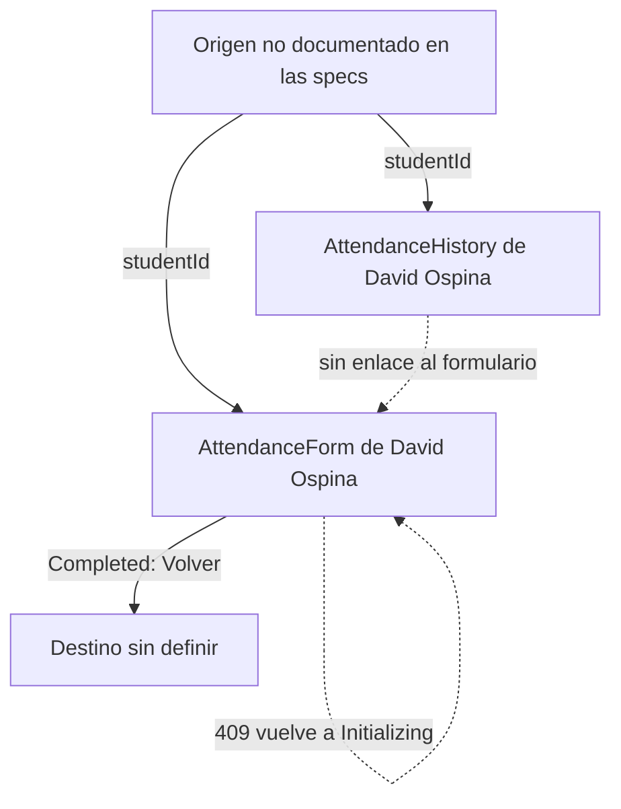

# Auditoría UX - Health Track

Pantallas auditadas: AttendanceHistory y AttendanceForm. Ambas reciben `studentId` por la ruta y muestran el nombre del estudiante en el encabezado (en los wireframes, David Ospina). Fuente: specs y wireframes de healt-track-docs. Las capturas `before-` salen de los wireframes de healt-track-docs, porque las pantallas de asistencia no existen todavía en el código de la app del equipo (v1.0.0).

| Pantalla          | Problema                                                                                                                            | Principio                           | Severidad | Arreglo propuesto                                                                                                 |
| :---------------- | :---------------------------------------------------------------------------------------------------------------------------------- | :---------------------------------- | :-------- | :---------------------------------------------------------------------------------------------------------------- |
| AttendanceHistory | La sección de accesibilidad de la spec está en "Pending": no hay etiquetas accesibles verificadas                                   | Accesibilidad                       | Alta      | `aria-label` en el botón de regreso y en cada tarjeta de sesión                                                   |
| AttendanceHistory | El estado de carga dice solo "skeleton rows", sin la forma de la fila                                                               | Estados de la interfaz              | Media     | `IonSkeletonText` con la forma de fecha, entrada, salida y etiquetas                                              |
| AttendanceHistory | El error es un mensaje genérico; offline sin datos guardados no se distingue de otros fallos                                        | Retroalimentación                   | Alta      | Mensaje claro con botón Reintentar y texto propio para "Sin conexión y sin historial guardado de este estudiante" |
| AttendanceHistory | El estado vacío es solo texto, sin ícono ni guía                                                                                    | Estados de la interfaz              | Media     | Ícono más "Todavía no hay sesiones registradas"                                                                   |
| AttendanceHistory | Los grupos musculares aparecen como texto plano separado por comas, sin forma de etiqueta, y las tarjetas no muestran la duración   | Jerarquía visual                    | Media     | Etiquetas visibles para cada músculo y la duración (`durationMinutes`) en cada tarjeta                            |
| AttendanceHistory | El banner "sin conexión, mostrando datos guardados" depende del color y su contraste no está verificado                             | Contraste / color como única señal  | Media     | Ícono y texto en el banner, contraste mínimo 4.5:1                                                                |
| AttendanceHistory | La lista carga de 20 en 20 sin indicar que viene la siguiente página                                                                | Retroalimentación                   | Media     | Spinner al final de la lista mientras carga la página siguiente                                                   |
| AttendanceHistory | A 360 px la tarjeta con cuatro datos (fecha, entrada, salida, músculos) puede quedar apretada                                       | Pantalla pequeña                    | Media     | Etiquetas que bajan de línea y espacios en `rem`                                                                  |
| AttendanceForm    | El único botón principal cambia de texto según el estado (Registrar entrada, Registrar salida, Confirmar)                           | Jerarquía visual / consistencia     | Media     | Mantener posición y tamaño fijos, y cambiar el color solo en Confirmar                                            |
| AttendanceForm    | El wireframe muestra a la vez "Registrar entrada", el bloque de músculos y Confirmar/Cancelar, y hay dos botones azules compitiendo | Jerarquía visual                    | Alta      | Mostrar solo el bloque del estado actual y un único botón principal                                               |
| AttendanceForm    | Un 409 (`SESSION_ALREADY_ACTIVE` o `SESSION_ALREADY_CLOSED`) devuelve la pantalla a Initializing sin explicar nada                  | Retroalimentación                   | Alta      | Toast: "El estado de la sesión cambió, la actualizamos"                                                           |
| AttendanceForm    | La lista de grupos musculares puede tener áreas táctiles menores de 44 px                                                           | Área táctil mínima                  | Alta      | Filas de al menos 44 px de alto                                                                                   |
| AttendanceForm    | "Cancelar" es un enlace secundario pequeño y descarta la selección sin avisar                                                       | Prevención de errores / área táctil | Media     | Botón de 44 px de alto con confirmación                                                                           |
| AttendanceForm    | Offline: el botón se deshabilita y solo se distingue por el gris                                                                    | Color como única señal              | Media     | Mensaje visible "sin conexión" junto al botón                                                                     |
| AttendanceForm    | El spinner de Initializing no tiene texto                                                                                           | Estados de la interfaz              | Baja      | "Revisando sesión activa..."                                                                                      |

## Mapa de navegación actual

Dónde se pierde el usuario:

- Las specs no definen cómo se llega a cada pantalla.
- El historial no tiene enlace al formulario.
- "Volver" del estado Completed no dice a dónde vuelve.
- Tras un 409 el usuario vuelve a Initializing sin explicación.
