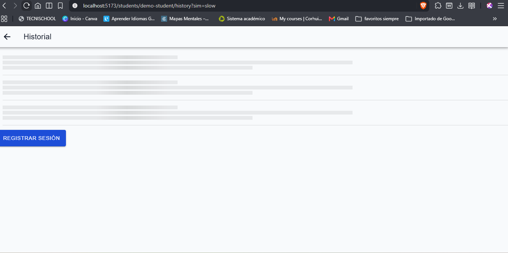
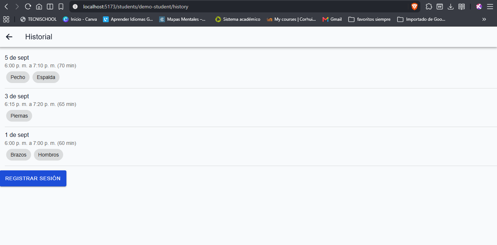
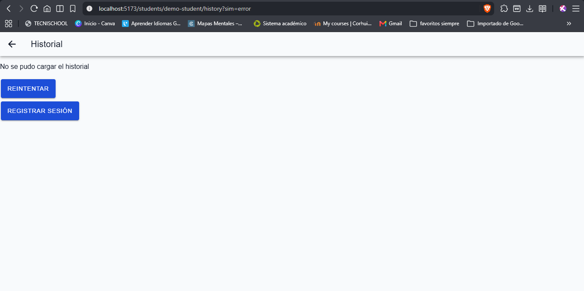
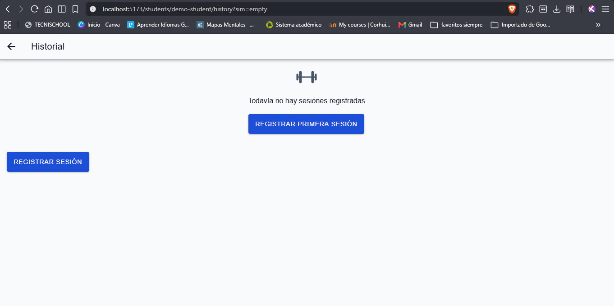

# Estados de la pantalla AttendanceHistory

Pantalla de lista de Health Track: muestra las sesiones cerradas de un estudiante (fecha, entrada, salida, duración y grupos musculares). La API de asistencia (E-08, `GET /students/:id/sessions`) todavía no existe en el backend, así que el servicio `attendanceService.ts` devuelve datos de ejemplo con la forma real de `Session` y simula la demora y el fallo.

## Cómo se fuerza cada estado

Se abre la ruta `/students/demo-student/history` y se agrega el parámetro `sim` al final de la URL:

| Estado    | URL                                        | Qué hace el servicio                          |
| :-------- | :----------------------------------------- | :-------------------------------------------- |
| Con datos | `/students/demo-student/history`           | Espera 0.8 s y devuelve 3 sesiones de ejemplo |
| Cargando  | `/students/demo-student/history?sim=slow`  | Espera 4 s antes de responder                 |
| Error     | `/students/demo-student/history?sim=error` | Lanza un error simulado                       |
| Vacío     | `/students/demo-student/history?sim=empty` | Devuelve una lista sin sesiones               |

## Cargando

Esqueleto (`IonSkeletonText`) con la forma real de cada fila: fecha, entrada y salida, y etiquetas de músculos. Mientras carga, la lista se marca como ocupada para los lectores de pantalla.

## Con datos

Cada tarjeta muestra la fecha, la hora de entrada y de salida con la duración en minutos (`durationMinutes`), y los grupos musculares (`muscleGroups`) como etiquetas con su nombre en español.

## Error

Mensaje "No se pudo cargar el historial" y botón Reintentar, que vuelve a pedir los datos. El mensaje se anuncia con `role="alert"`. También se puede recargar deslizando hacia abajo (`IonRefresher`).

## Vacío

Cuando el estudiante no tiene sesiones cerradas se muestra un ícono de pesa (decorativo, oculto para el lector de pantalla), el mensaje "Todavía no hay sesiones registradas" y el botón principal "Registrar primera sesión", que lleva a `AttendanceForm` en `/students/:studentId/attendance`. El botón mide al menos 44 px de alto (`--ht-touch-min`).

## Prueba automática

`src/features/attendance/__tests__/AttendanceHistory.test.tsx` simula que el servicio falla la primera vez, comprueba que aparece el mensaje de error, pulsa Reintentar y verifica que el servicio se llama otra vez.
