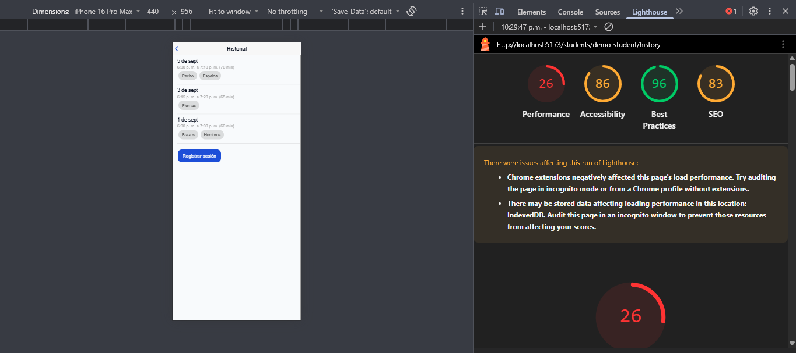
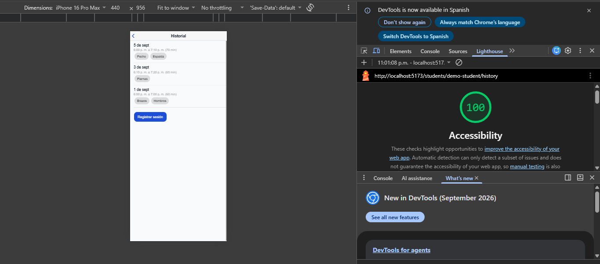
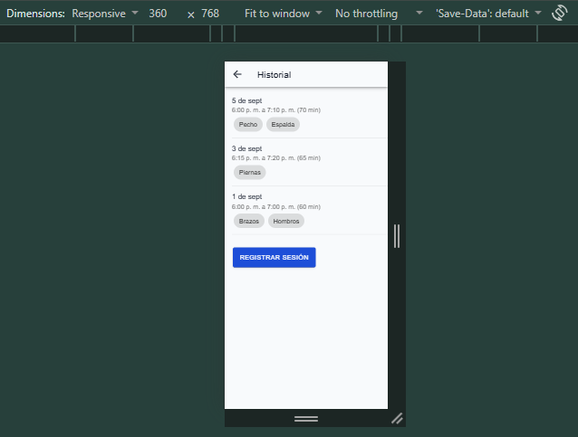
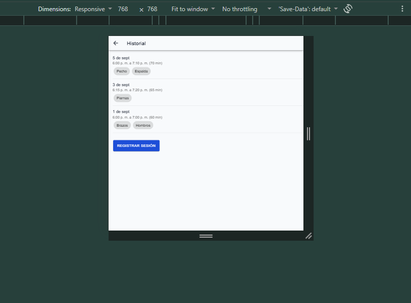
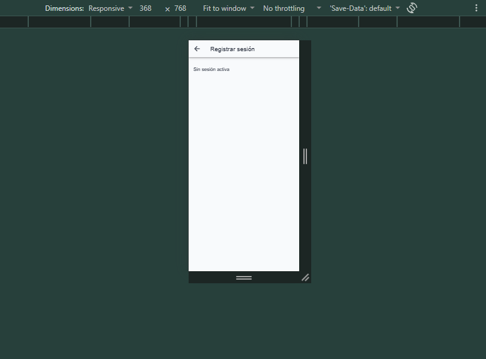
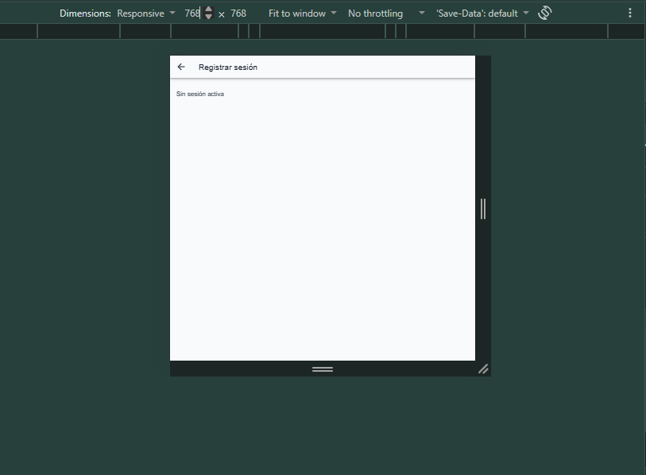

# Accesibilidad y responsive (CP4)

## Lo corregido

- `app/index.html`: se quitó `user-scalable=no`, `minimum-scale` y `maximum-scale` del meta viewport, que bloqueaban el zoom. El título pasó a "Health Track".
- `HistoryList.tsx`: cada tarjeta de sesión tiene `aria-label` con fecha, horas, duración y músculos de esa sesión.
- Revisión de tokens, tamaños y áreas táctiles: los estilos en línea ya usaban `--ht-touch-min` y `--ht-text-muted`, todo está en `rem` o `%`, y ningún estado depende solo del color. No hizo falta cambiar más código.

## Lighthouse (Accessibility, Mobile)

| Medición | Puntaje | Condiciones |
|---|---|---|
| Antes | 86 | Chrome normal, con extensiones |
| Después | 100 | Ventana de incógnito, sin extensiones, Lighthouse 13.4.1 |

Nota honesta: el "antes" se midió con extensiones activas. Los botones sin nombre accesible venían de una extensión de Chrome, no de mi código. Por eso la comparación no es del todo equivalente. Lo que sí corregí fue el `user-scalable=no`.

## Capturas responsive

Historial a 360 px:

Historial a 768 px:

Formulario a 360 px:

Formulario a 768 px:

