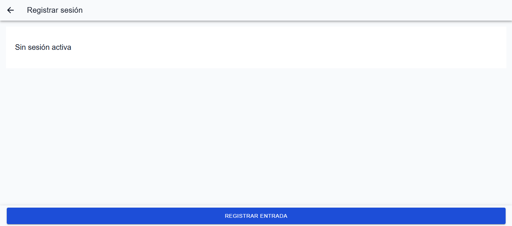
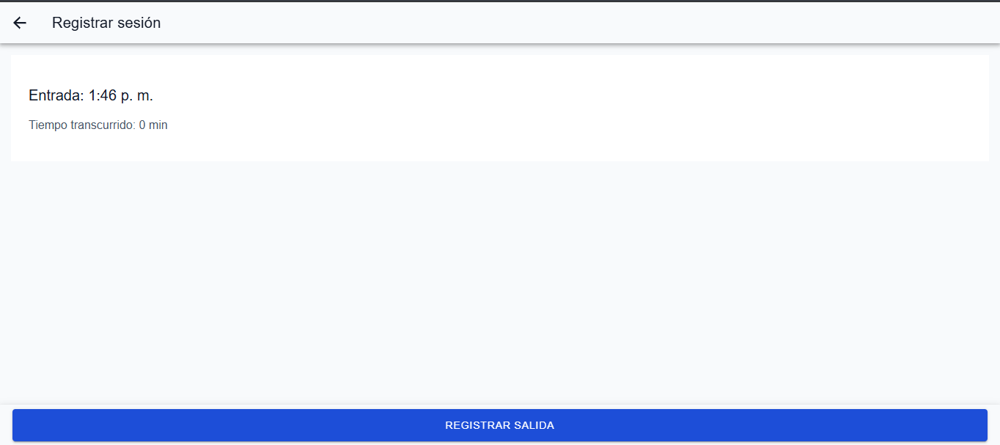
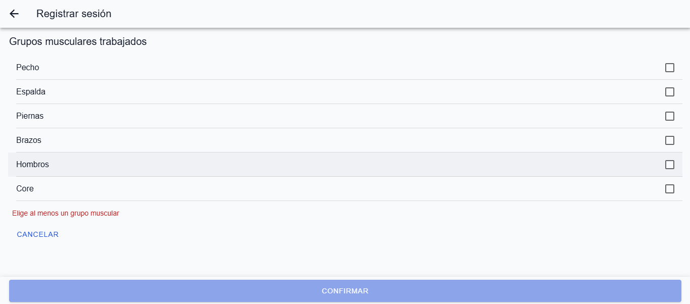
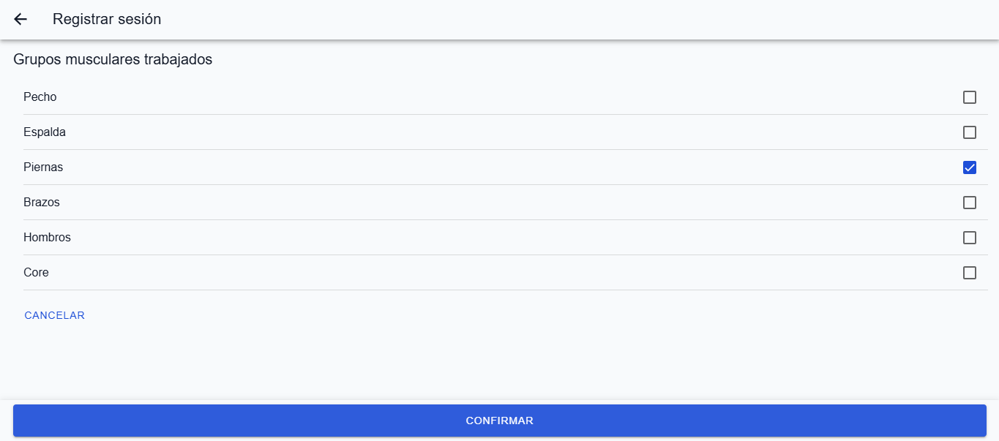
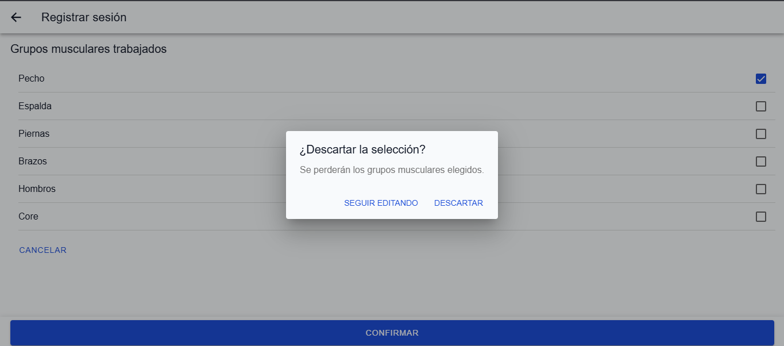
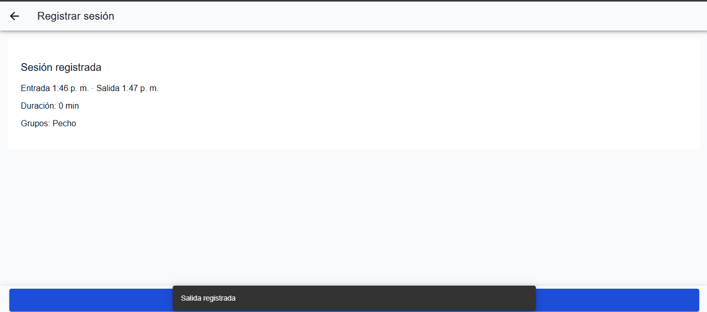
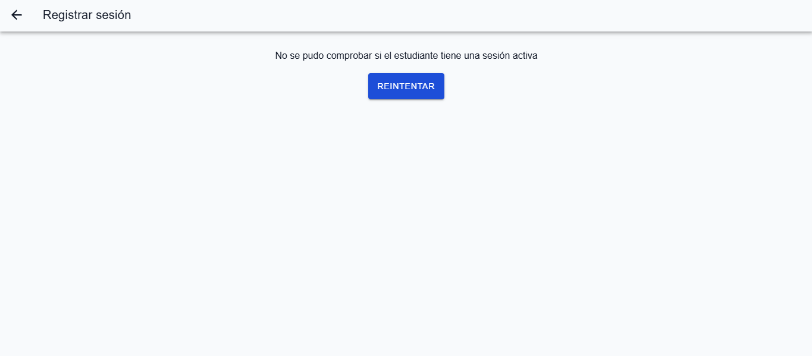
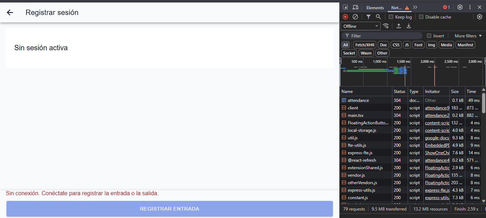

# Formulario de salida de AttendanceForm

AttendanceForm registra la entrada de un estudiante y, al terminar, su salida con los grupos musculares que trabajó. El formulario principal que elegí para este checkpoint es el de salida (check-out): es el único con un campo que el entrenador llena. La entrada es un botón sin campos.

Los endpoints de sesiones (E-05 a E-08) no existen en `h-tracker` v1.0.0 (brecha G-07 del contrato), así que `attendanceService.ts` los simula con la forma real de `Session`.

## Qué simula el servicio

| Función | Endpoint | Qué hace |
| :-- | :-- | :-- |
| `getActiveSession` | E-07 `GET /students/:id/sessions/active` | Devuelve la sesión abierta o `null` (el caso `204`) |
| `registerCheckIn` | E-05 `POST /students/:id/sessions` | Abre una sesión; si ya hay una responde `409 SESSION_ALREADY_ACTIVE` |
| `registerCheckOut` | E-06 `PATCH /sessions/:id` | Cierra la sesión y calcula `durationMinutes`; `409 SESSION_ALREADY_CLOSED` si ya no está abierta, `422 MUSCLE_GROUPS_REQUIRED` si no hay grupos |

## Cómo se fuerza cada estado

Se abre `/students/demo-student/attendance` y se agrega `sim` a la URL:

| Estado | URL | Qué hace el servicio |
| :-- | :-- | :-- |
| Normal | `/students/demo-student/attendance` | Espera 0.8 s por llamada |
| Cargando | `...?sim=slow` | Espera 4 s por llamada |
| Error del servidor | `...?sim=error` | Lanza un error simulado |
| Conflicto | `...?sim=conflict` | Responde `409` al registrar entrada o salida |

Para ver el error al confirmar la salida con la selección ya hecha: se carga la pantalla sin `sim`, se llega al formulario, se marca un grupo, y en la consola del navegador se ejecuta `history.replaceState(null, '', location.pathname + '?sim=error')` antes de pulsar Confirmar. Para el estado sin conexión: DevTools, pestaña Network, opción Offline.

## Reglas de validación

El formulario tiene un solo campo, `muscleGroups`, porque la spec de AttendanceForm no define otro. No agregué campos que la spec no pide.

| Regla | Por qué existe en el dominio | Cómo se aplica | Contrato |
| :-- | :-- | :-- | :-- |
| Al menos un grupo muscular | El historial existe para que el entrenador planee rutinas balanceadas; una sesión sin músculos trabajados no sirve para eso | Mensaje "Elige al menos un grupo muscular" bajo la lista, botón Confirmar deshabilitado, y `submitCheckout` no envía si la selección está vacía | `422 MUSCLE_GROUPS_REQUIRED` |
| Solo grupos del catálogo (`CHEST`, `BACK`, `LEGS`, `ARMS`, `SHOULDERS`, `CORE`) | El backend guarda valores exactos y distingue mayúsculas (D-04) | La lista sale de `MUSCLE_LABELS`; no hay entrada de texto libre | `422 MUSCLE_GROUP_INVALID` |
| Sin grupos repetidos | Un grupo trabajado en la sesión se cuenta una sola vez | Cada casilla alterna entre marcada y desmarcada, así que la selección nunca repite un valor | `422 MUSCLE_GROUP_DUPLICATE` |

El servicio simulado solo implementa el `422` de la selección vacía. Los otros dos no tienen mensaje en pantalla porque la interfaz no permite producirlos.

## Lo que el formulario no captura

- **Duración:** la calcula el backend como `floor` de los minutos entre entrada y salida (D-03). Se muestra tal como llega, y `0` es un valor válido.
- **Fechas:** las pone el reloj del servidor; el cliente nunca las envía.
- **Autor de la operación:** no se envía; el contrato no acepta `trainerId`.

## Estados y retroalimentación

| Situación | Qué ve el entrenador |
| :-- | :-- |
| Comprobando si hay sesión activa | Spinner |
| Falla esa comprobación inicial | Mensaje con botón Reintentar |
| Sin sesión activa | "Sin sesión activa" y botón "Registrar entrada" |
| Registrando entrada o guardando salida | Botón deshabilitado con spinner, para evitar un doble envío (un repetido recibiría `409`, D-08) |
| Sesión activa | Hora de entrada y tiempo transcurrido, que se actualiza cada 30 s; botón "Registrar salida" |
| Formulario de salida | Lista de grupos; mensaje de validación y Confirmar deshabilitado hasta marcar uno |
| Cancelar con grupos marcados | `IonAlert` "¿Descartar la selección?" (acción destructiva: se pierde la selección); sin selección vuelve directo a la sesión activa |
| Éxito | `IonToast` "Salida registrada" y resumen con entrada, salida, duración y grupos; el botón "Volver" lleva al historial |
| Falla del servidor al confirmar | Mensaje en línea, la selección se conserva y el botón pasa a "Reintentar" |
| `409` (`SESSION_ALREADY_ACTIVE` o `SESSION_ALREADY_CLOSED`) | Aviso "El estado de la sesión cambió, la actualizamos" y la pantalla vuelve a consultar la sesión, sin ofrecer reintento, como pide la spec |
| Sin conexión | Aviso en texto rojo sobre el botón; "Registrar entrada" y Confirmar deshabilitados |

Sin conexión, "Registrar salida" sigue activo porque solo abre la lista, sin llamar al servidor. No hay escrituras sin conexión (D-07). La detección usa `navigator.onLine` y los eventos `online` y `offline` del navegador.

## Capturas

| Estado | Captura |
| :-- | :-- |
| Sin sesión activa |  |
| Sesión activa |  |
| Validación: mensaje y Confirmar deshabilitado |  |
| Un grupo marcado y Confirmar habilitado |  |
| Alerta al cancelar con selección |  |
| Sesión registrada |  |
| Error del servidor en línea |  |
| Sin conexión |  |

## Qué está probado y cómo

- **Automático (Vitest):** `attendanceService.test.ts` cubre la segunda entrada con `409`, la salida vacía con `422`, el `409` de sesión ya cerrada, `durationMinutes` en `0` y el redondeo hacia abajo. `AttendanceForm.test.tsx` cubre el mensaje de validación, su desaparición al marcar un grupo, los seis grupos del catálogo y el error en línea.
- **Manual en el navegador:** el botón Confirmar deshabilitado, la alerta al cancelar, el aviso de éxito, la recarga tras un `409` y el comportamiento sin conexión. No están automatizados porque dependen de eventos de Ionic.

## Limitaciones conocidas

- El estado del servidor simulado vive en memoria y se pierde al recargar la página.
- El historial (E-08 simulado) devuelve tres sesiones fijas, así que una sesión registrada aquí no aparece en él hasta que exista el endpoint real.
- La detección sin conexión se basa en `navigator.onLine`; no comprueba que el servidor responda.