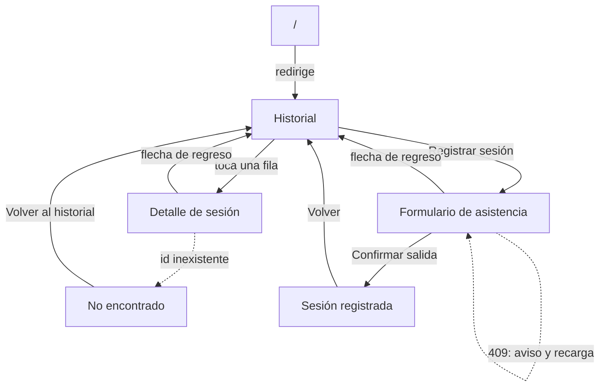
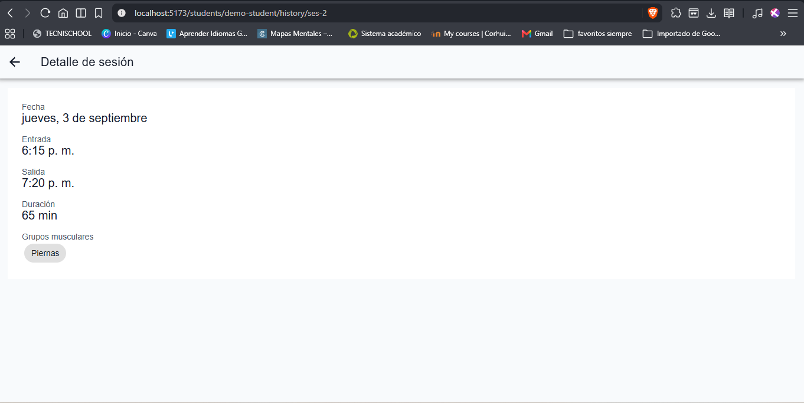
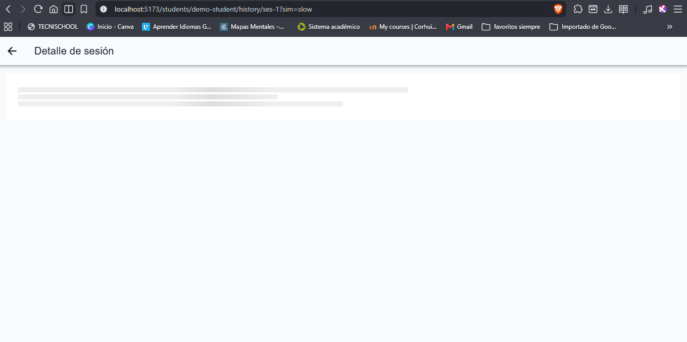
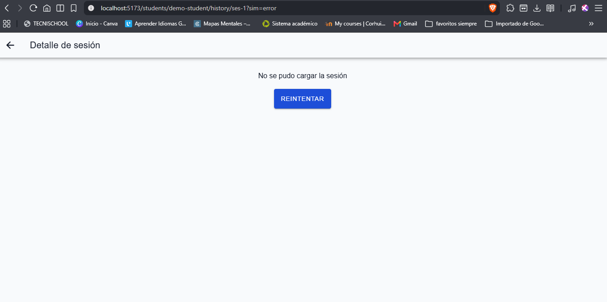
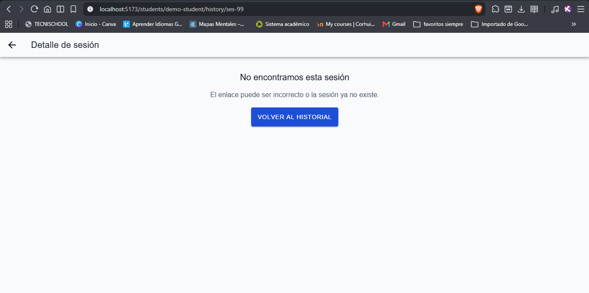

# Navegación y pantalla de detalle

Este documento recoge el mapa de navegación de mis pantallas de Health Track después del CP7 y lo compara con el del CP1 (`01-ux-audit.md`). También documenta la pantalla de detalle de sesión, que no existe en la spec.

## Rutas y parámetros

| Ruta | Parámetros | Pantalla |
| :-- | :-- | :-- |
| `/` | — | Redirige a `/students/demo-student/history` |
| `/students/:studentId/history` | `studentId` | Historial de sesiones cerradas |
| `/students/:studentId/history/:sessionId` | `studentId`, `sessionId` | Detalle de una sesión |
| `/students/:studentId/attendance` | `studentId` | Formulario de asistencia |

La spec no define de dónde viene el `studentId`. Por eso `/` redirige a un estudiante de ejemplo (`demo-student`); en la app del equipo vendría de la lista de estudiantes.

## Mapa de navegación nuevo

## Comparación con el mapa del CP1

| Pérdida del usuario en el CP1 | Cómo quedó |
| :-- | :-- |
| Las specs no definen cómo se llega a cada pantalla | `/` redirige al historial y las rutas llevan el `studentId` |
| El historial no tenía enlace al formulario | Botón "Registrar sesión" en el historial (en el estado vacío, "Registrar primera sesión") |
| "Volver" del estado Completed no decía a dónde volvía | Lleva al historial |
| Tras un 409 el usuario volvía a Initializing sin explicación | Aviso "El estado de la sesión cambió, la actualizamos" |
| No había forma de ver una sesión individual | Cada fila del historial abre su detalle |

Pasos que el flujo le ahorra al usuario, contados en toques:

- Llegar al formulario desde el historial: antes no había camino y había que escribir la URL a mano; ahora es 1 toque.
- Ver una sesión concreta: antes no era posible; ahora es 1 toque sobre la fila.
- Volver al historial después de registrar la salida: antes no tenía destino; ahora es 1 toque en "Volver".

## Pantalla de detalle de sesión

Se abre desde cada fila del historial y recibe `studentId` y `sessionId` por la ruta. Tiene botón de regreso y estos estados:

| Estado | Cómo se fuerza | Qué se ve |
| :-- | :-- | :-- |
| Cargando | `/students/demo-student/history/ses-1?sim=slow` | Esqueleto durante unos 4 s |
| Datos | `/students/demo-student/history/ses-2` | Fecha, entrada, salida, duración y grupos musculares |
| Error | `/students/demo-student/history/ses-1?sim=error` | Mensaje con botón Reintentar |
| No encontrado | `/students/demo-student/history/ses-99` | "No encontramos esta sesión" y botón "Volver al historial" |

## Endpoint propuesto

La spec de AttendanceHistory y el contrato de la API no incluyen una pantalla de detalle de sesión ni un endpoint para leer una sola sesión: E-08 lista las sesiones cerradas y E-07 solo devuelve la activa. Esto es una **propuesta nueva**, no algo que ya exista en el contrato.

- **Endpoint propuesto:** `GET /students/:id/sessions/:sessionId`, anidado bajo el estudiante como E-05, E-07 y E-08.
- **Respuesta:** un `Session` cerrado.
- **Errores:** `404 STUDENT_NOT_FOUND` y `404 SESSION_NOT_FOUND`, dos códigos que el contrato ya define.
- **Alternativa descartada:** `GET /sessions/:id`, porque no valida a qué estudiante pertenece la sesión.
- **Por qué hace falta:** abrir el detalle desde un enlace directo funciona sin depender de que la lista haya cargado antes.

Mientras no exista, `getSessionDetail` en `attendanceService.ts` lo simula con las mismas tres sesiones de ejemplo del historial (`ses-1` a `ses-3`).

## Qué está probado y cómo

- **Automático (Vitest):** `sessionDetail.test.ts` cubre los cuatro caminos del hook `useSessionDetail`: cargando a listo, no encontrado, error y reintento.
- **Manual en el navegador:** el toque sobre una fila, el botón de regreso, los cuatro estados de la pantalla y que el formulario siguió funcionando.

## Limitaciones conocidas

- Solo existen tres ids de ejemplo (`ses-1`, `ses-2` y `ses-3`). Una sesión registrada en el formulario no aparece en el historial ni en el detalle.
- El endpoint propuesto no está en el contrato ni en el backend; hay que acordarlo con el equipo.