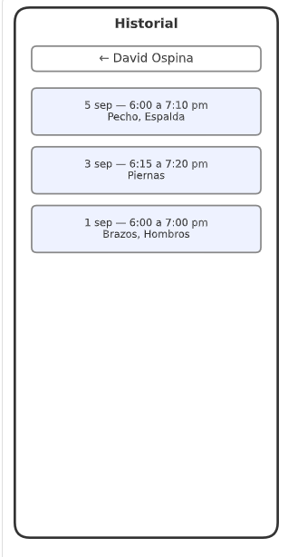
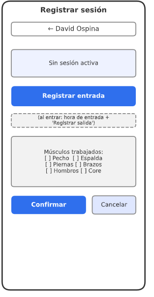

# Antes y después

Comparación de las pantallas que trabajé. Los principios son los que usé en la auditoría del CP1 (`01-ux-audit.md`).

## AttendanceHistory

| Antes | Después |
| :-- | :-- |
|  |  |

**Qué cambió:** la lista pasó de ser un wireframe sin estados a una pantalla con cargando, vacío y error con Reintentar, con cada sesión como enlace a su detalle y un nombre accesible en cada fila.
**Principios aplicados:** estados de la interfaz, retroalimentación, accesibilidad y pantalla pequeña.

## AttendanceForm

| Antes | Después |
| :-- | :-- |
|  |  |

**Qué cambió:** el formulario pasó de un wireframe a un flujo completo: comprobar la sesión activa, registrar la entrada, elegir grupos musculares con mensaje de validación bajo el campo, confirmar con retroalimentación y manejo del error, el conflicto y la falta de conexión.
**Principios aplicados:** prevención de errores, retroalimentación, estados de la interfaz, área táctil mínima y color no como única señal.

## SessionDetail (pantalla nueva)

No tiene "antes": la spec no define una pantalla de detalle de sesión. La documenté como propuesta en `07-navigation-flow.md`.

| Después |
| :-- |
|  |

**Qué aporta:** permite ver fecha, entrada, salida, duración y grupos de una sesión, con estados de cargando, error y no encontrado.
**Principios aplicados:** jerarquía visual y estados de la interfaz.

## Historias de usuario para el equipo

### Historia 1: ver el detalle de una sesión

Como entrenador, quiero abrir una sesión del historial de un estudiante para ver su fecha, hora de entrada y salida, duración y grupos musculares trabajados.

**Criterios de aceptación:**
1. Al tocar una sesión del historial se abre una pantalla con el `studentId` y el `sessionId` en la ruta.
2. La pantalla muestra `checkInAt`, `checkOutAt`, `durationMinutes` y todos los `muscleGroups` de esa sesión.
3. Mientras carga se ve un esqueleto; si falla se ve un mensaje con el botón Reintentar.
4. Con un `sessionId` que no existe se ve "No encontramos esta sesión" y un botón para volver al historial.
5. Existe en el backend `GET /students/:id/sessions/:sessionId`, que responde `404 SESSION_NOT_FOUND` si la sesión no existe.

### Historia 2: registrar la salida con validación

Como entrenador, quiero registrar la salida de un estudiante eligiendo los grupos musculares trabajados, para que el historial sirva para planear rutinas balanceadas.

**Criterios de aceptación:**
1. El botón Confirmar está deshabilitado y se ve el mensaje "Elige al menos un grupo muscular" mientras no haya ningún grupo marcado.
2. Solo se pueden marcar los seis grupos del catálogo (`CHEST`, `BACK`, `LEGS`, `ARMS`, `SHOULDERS`, `CORE`).
3. Se puede quitar un grupo tocándolo de nuevo, o con el botón "Limpiar selección".
4. Al confirmar se ve un spinner; si el servidor falla se ve un mensaje en línea y la selección se conserva.
5. Si el servidor responde `409 SESSION_ALREADY_CLOSED`, la pantalla vuelve a consultar la sesión activa sin ofrecer reintento.
6. La duración mostrada es `durationMinutes` tal como la devuelve el backend, y `0` se muestra como "0 min".

### Historia 3: avisar cuando no hay conexión

Como entrenador, quiero que la app me avise cuando no hay conexión, para no creer que registré una entrada o una salida que no se guardó.

**Criterios de aceptación:**
1. Sin conexión, los botones "Registrar entrada" y "Confirmar" están deshabilitados.
2. Sin conexión se ve el texto "Sin conexión. Conéctate para registrar la entrada o la salida." junto al botón, además del botón deshabilitado.
3. Al recuperar la conexión, el aviso desaparece y los botones vuelven a funcionar sin recargar la pantalla.
4. "Registrar salida" sigue activo sin conexión, porque solo abre la lista de grupos y no llama al servidor.
5. Ninguna escritura se encola ni se guarda para enviarla después.

## Dependencias del backend

Las tres historias dependen de los endpoints E-05 a E-08 y de la tabla `session`, que no existen en `h-tracker` v1.0.0 (brecha G-07 del contrato). La historia 1 además necesita el endpoint propuesto en `07-navigation-flow.md`.