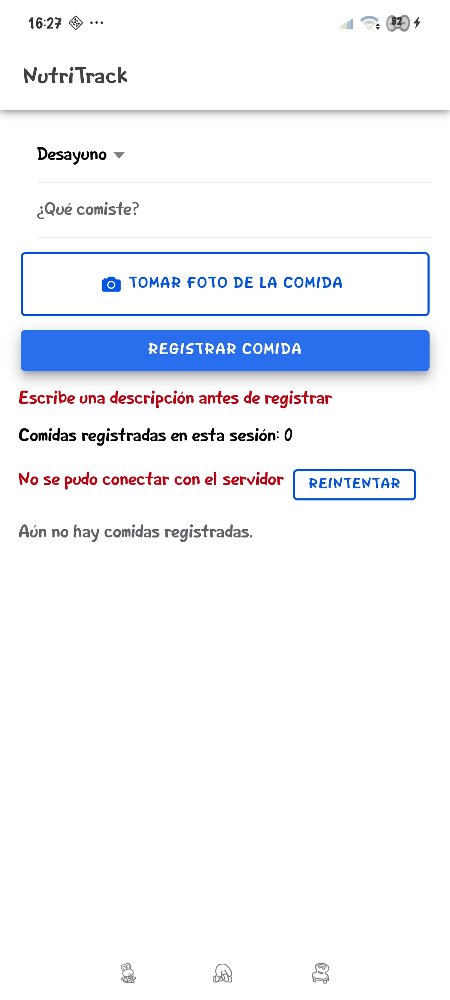
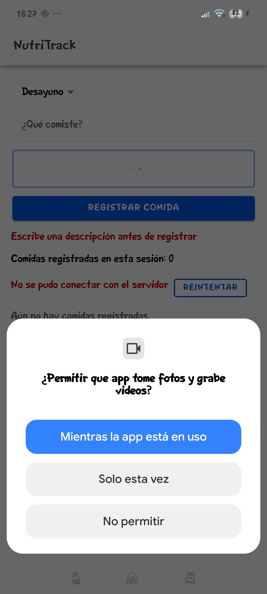
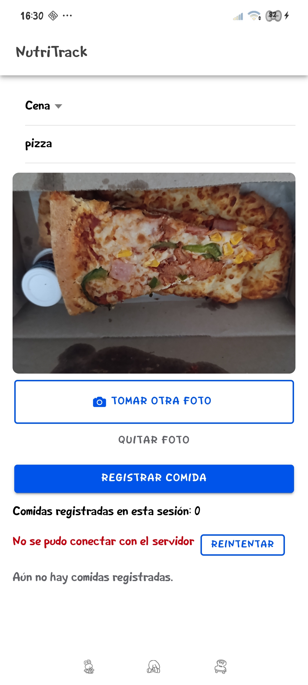
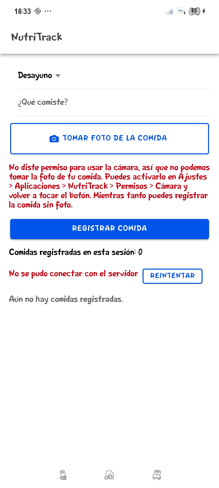
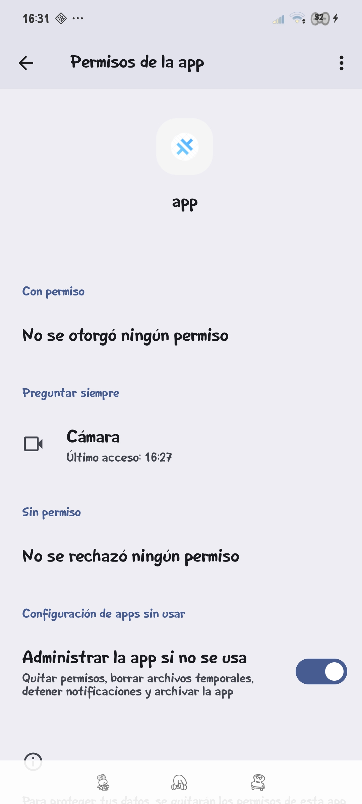

# Semana 12 · NutriTrack: foto de la comida con la cámara (Capacitor)

Asignatura: Programación Móvil

## Descripción

Se integró el plugin de cámara de Capacitor (`@capacitor/camera`) en el formulario de NutriTrack para que el usuario pueda tomar una foto de lo que comió antes de registrar la comida. La app pide el permiso de la cámara y, si el usuario lo niega, le explica qué pasó y cómo activarlo, sin romperse y dejando registrar la comida sin foto.

## ¿Por qué la cámara?

NutriTrack es un diario de comidas, y hasta ahora el usuario solo podía escribir una descripción. Una foto ayuda a recordar qué y cuánto comió, y es más rápido que escribir cuando está comiendo. La foto es opcional: el flujo de registrar una comida con texto sigue funcionando igual si no se toma ninguna.

## Cómo funciona

```
FotoComida.tsx  ->  fotoService.ts  ->  plugin @capacitor/camera  ->  cámara del teléfono
```

### 1. Declarar el permiso en Android

Para que Android muestre el diálogo de permiso hay que declarar `CAMERA` en `android/app/src/main/AndroidManifest.xml`, junto al permiso de `INTERNET`:

```xml
<uses-permission android:name="android.permission.CAMERA" />
```

Si no se declara, el plugin entiende que no necesita permiso y abre la cámara sin preguntar, así que nunca se podría probar el caso de permiso negado.

### 2. Pedir el permiso y tomar la foto (`services/fotoService.ts`)

Toda la lógica del plugin está en un servicio aparte, igual que las llamadas a la API están en `comidasApi.ts`. Primero se revisa el permiso con `checkPermissions()`, y si el usuario todavía no ha respondido se le pregunta con `requestPermissions()`, que es lo que hace aparecer el diálogo de Android. Solo si hay permiso se abre la cámara con `getPhoto`:

```ts
let permiso = await Camera.checkPermissions();
if (permiso.camera === 'prompt' || permiso.camera === 'prompt-with-rationale') {
  permiso = await Camera.requestPermissions({ permissions: ['camera'] });
}
if (permiso.camera === 'denied') {
  return { tipo: 'denegado' };
}
const foto = await Camera.getPhoto({ quality: 80, resultType: CameraResultType.Uri, source: CameraSource.Camera });
```

El servicio nunca deja escapar un error sin explicación. Siempre devuelve uno de cuatro resultados:

| Resultado | Cuándo pasa |
|---|---|
| `ok` | Hay permiso y la cámara devolvió la foto |
| `denegado` | El usuario no dio el permiso (en el diálogo o antes, desde Ajustes) |
| `cancelado` | El usuario abrió la cámara y la cerró sin tomar la foto |
| `error` | Cualquier otro fallo, por ejemplo la cámara no respondió |

Nota: en la versión 8 del plugin `getPhoto` aparece como obsoleto (el reemplazo es `takePhoto`), pero sigue funcionando y es el método que se vio en clase.

### 3. Qué pasa si el usuario niega el permiso

La app sigue funcionando. Debajo del botón aparece este mensaje:

> No diste permiso para usar la cámara, así que no podemos tomar la foto de tu comida. Puedes activarlo en Ajustes > Aplicaciones > NutriTrack > Permisos > Cámara y volver a tocar el botón. Mientras tanto puedes registrar la comida sin foto.

Se indica la ruta de Ajustes porque, si el usuario niega el permiso dos veces, Android ya no vuelve a mostrar el diálogo y la única forma de darlo es desde ahí. Si el usuario cierra la cámara a propósito (`cancelado`) no se muestra ningún mensaje, porque no es un error.

### 4. El componente (`components/FotoComida.tsx`)

Muestra el botón "Tomar foto de la comida" (mínimo 3.5rem de alto, para que sea fácil de tocar), un spinner mientras la cámara se abre, la foto como vista previa, y los botones "Tomar otra foto" y "Quitar foto". `FormularioComida` guarda la foto en un `useState` y la limpia cuando la comida se registra bien.

| Estado | Qué ve el usuario |
|---|---|
| Sin foto | Botón "Tomar foto de la comida" |
| Abriendo la cámara | Spinner y el botón desactivado |
| Foto tomada | Vista previa, "Tomar otra foto" y "Quitar foto" |
| Permiso negado | El mensaje anterior en rojo |
| Otro fallo | Mensaje que pide intentar de nuevo |

## Qué queda para más adelante

La foto se muestra como vista previa en el formulario, pero la API todavía no la guarda: el endpoint `POST /comidas` solo recibe franja y descripción. Para guardarla haría falta que la API acepte una imagen (por ejemplo como archivo o en base64) y un lugar donde almacenarla.

## Estructura

```
12-week/03-optional-activity/
├── api/                                  -> igual que en la semana 10
└── app/
    ├── capacitor.config.ts               -> appName: NutriTrack
    ├── android/                          -> proyecto nativo generado por Capacitor
    │   ├── gradle.properties             -> permite compilar con tildes en la ruta
    │   └── app/src/main/AndroidManifest.xml  -> permiso CAMERA
    └── src/
        ├── services/
        │   └── fotoService.ts            -> permiso + cámara (nuevo)
        └── components/
            ├── FotoComida.tsx / .css     -> botón, vista previa y mensajes (nuevo)
            └── FormularioComida.tsx      -> ahora incluye FotoComida
```

## Cómo ejecutarlo en un teléfono Android

Se necesita Android Studio y el teléfono con la depuración USB activada.

```
cd app
npm install
npm install @capacitor/camera @capacitor/android
npx cap add android      # una sola vez
npm run build
npx cap sync android
npx cap open android
```

En Android Studio se conecta el teléfono por USB y se presiona Run. En Windows, si la ruta de la carpeta tiene tildes ("Programación móvil"), Android Studio no compila, y por eso en `android/gradle.properties` se agregó `android.overridePathCheck=true`.

La API corre en `localhost:3000`, que en el teléfono no es el computador, así que "Registrar comida" no puede guardar desde el teléfono. La foto no depende de la API, por eso se puede probar igual.

## Evidencias en el teléfono

Todas las capturas se tomaron en un celular Android real con la app instalada desde Android Studio.

| Botón en el formulario | Diálogo de permiso | Foto tomada |
|---|---|---|
|  |  |  |

| Permiso negado | Permiso desactivado en Ajustes |
|---|---|
|  |  |
