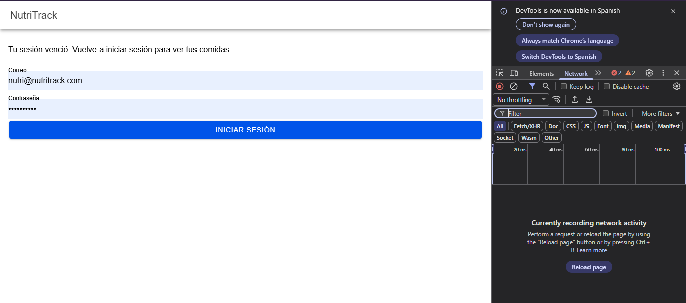
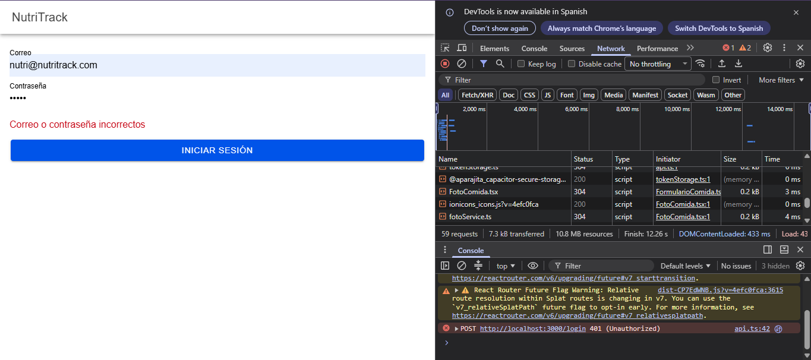
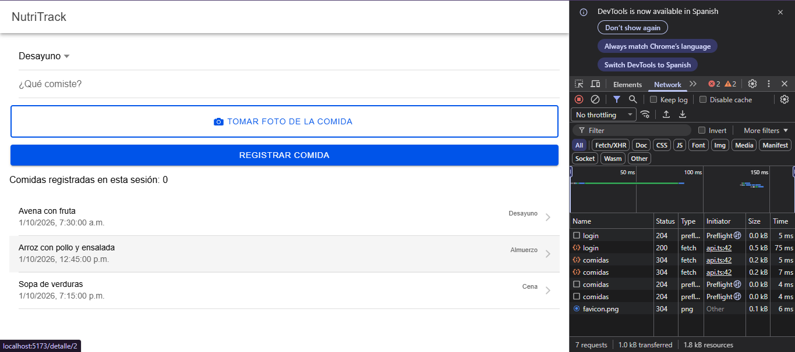
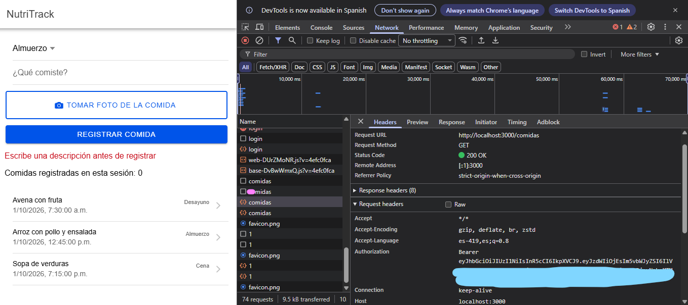
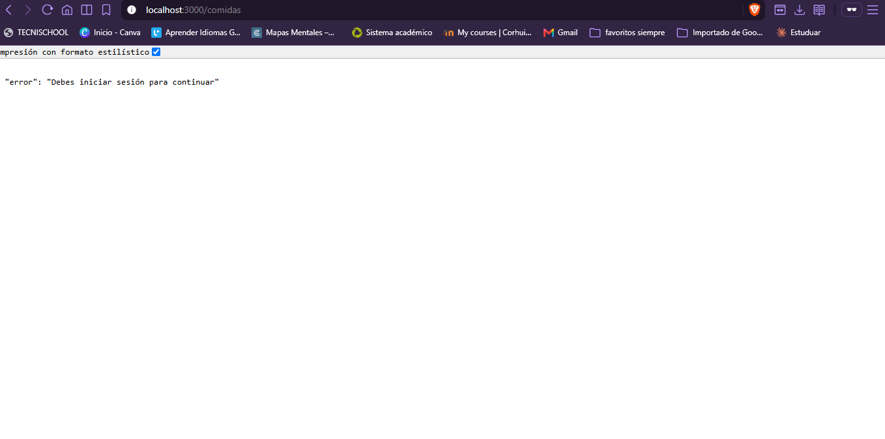
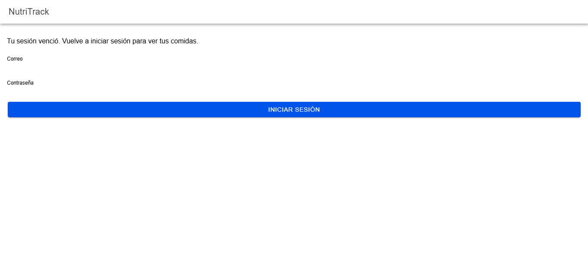
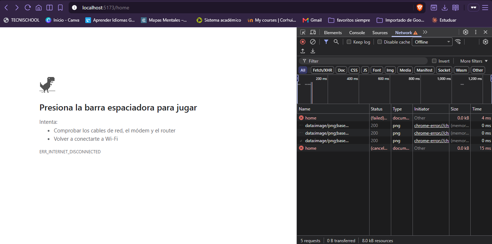
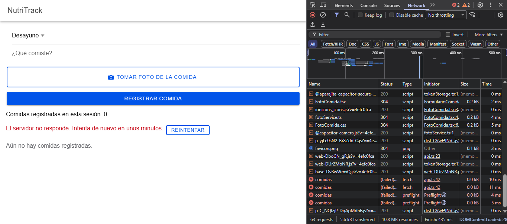
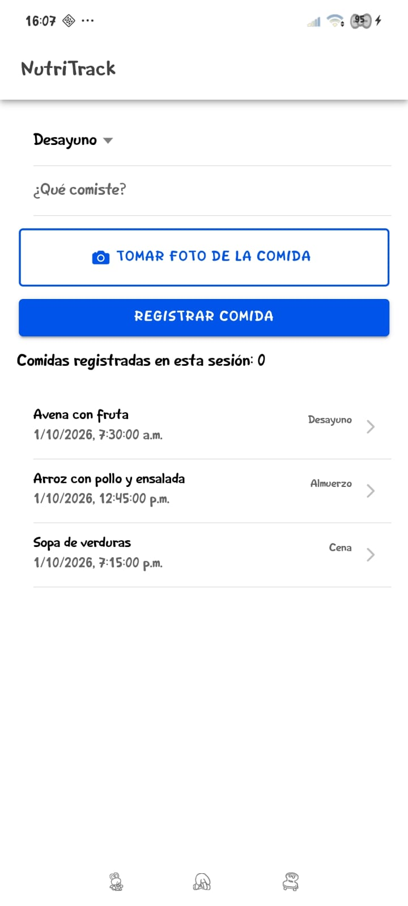
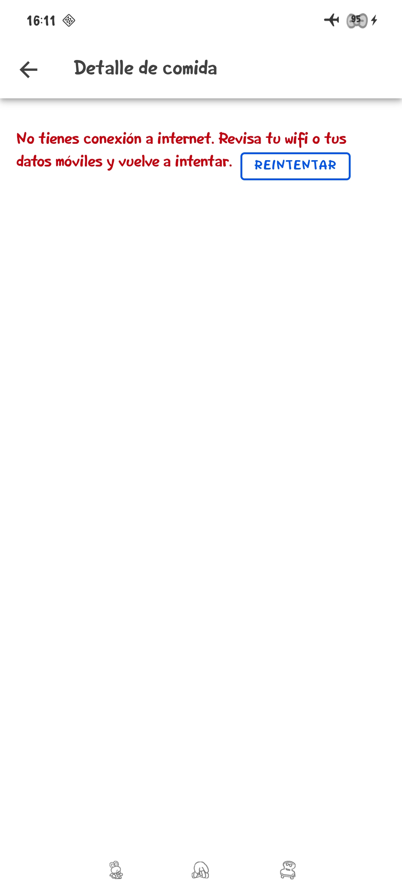

# Semana 13 · NutriTrack: inicio de sesión con token y manejo de la conexión

Asignatura: Programación Móvil · Individual

## Descripción

Hasta la semana 12 cualquiera podía pedir las comidas a la API. Ahora el usuario inicia sesión, la API le entrega un token JWT, la app lo guarda en el almacenamiento seguro del teléfono y lo envía en cada petición a `/comidas`. Además, la app no se queda pegada cuando algo falla: avisa si el token venció (401), si no hay internet y si el servidor no responde. Todo el acceso a la API está en un solo servicio (`services/api.ts`).

## Cómo funciona

```
Pantalla (Login, Home, Detalle)
  └─> authApi.ts / comidasApi.ts   (qué endpoint se llama)
        └─> api.ts                 (red, token, URL y errores: un solo lugar)
              ├─> tokenStorage.ts  (almacenamiento seguro)
              └─> API Express ─> verificarToken ─> /comidas
```

- **API:** `POST /login` valida correo y clave (hash scrypt) y devuelve un JWT que vence (`JWT_EXPIRES_IN`). El middleware `verificarToken` protege `/comidas` y responde 401 sin token, vencido o inválido. Cada usuario ve solo sus comidas (el id sale del token).
- **Token seguro:** `@aparajita/capacitor-secure-storage` (Android Keystore / iOS Keychain). En el navegador usa localStorage sin cifrar, solo para desarrollo.
- **Servicio central (`api.ts`):** 1) revisa la red con `@capacitor/network`, 2) agrega `Authorization: Bearer`, 3) distingue "servidor no responde", 4) ante 401 borra el token y vuelve al login, 5) revisa `resp.ok` para el resto de errores.
- **Volver al login:** `VigilanteSesion` en `App.tsx` recibe el aviso del servicio y redirige con `'root'` para limpiar el historial.

## Cómo ejecutarlo

```bash
# API (Node 20.6+)
cd api
npm install jsonwebtoken
copy .env.example .env     # Mac/Linux: cp .env.example .env
# escribe una clave en JWT_SECRET dentro de .env
node --env-file=.env server.js

# App
cd app
npm install @aparajita/capacitor-secure-storage @capacitor/network
npm run dev
```

Usuario de prueba: `nutri@nutritrack.com` / `Nutri2026*`

Casos a probar: login correcto e incorrecto; cabecera Authorization en F12 > Red; `/comidas` sin token (401); token vencido (`JWT_EXPIRES_IN=1m`); sin conexión (F12 > Red > Sin conexión); servidor apagado.

En Android: `npm run build`, `npx cap sync android`, `adb reverse tcp:3000 tcp:3000`, `npx cap open android`. El archivo `network_security_config.xml` permite HTTP solo hacia `localhost`.

## Nota sobre el modo de desarrollo

La API corre por HTTP en `localhost`. Por eso, solo para desarrollo, `capacitor.config.ts` tiene `allowMixedContent: true` y Android tiene una excepción de HTTP únicamente hacia `localhost` (`network_security_config.xml`). En producción la API iría por HTTPS y ambas cosas se quitarían.

## Evidencias

### En el navegador

| Caso | Captura |
|---|---|
| Pantalla de inicio de sesión |  |
| Datos incorrectos: "Correo o contraseña incorrectos" |  |
| Lista de comidas después de entrar con el token |  |
| Cabecera `Authorization: Bearer ...` en la petición a `/comidas` (200). El final del token está difuminado porque un token no se publica |  |
| `/comidas` sin token: 401 "Debes iniciar sesión para continuar" |  |
| Token vencido: la app vuelve al login y explica por qué |  |
| Sin conexión: "No tienes conexión a internet" con Reintentar |  |
| Servidor apagado: "El servidor no responde" |  |

### En el celular (Android real)

| Caso | Captura |
|---|---|
| Sesión guardada: la app entra directo a la lista tras cerrarla por completo y reabrirla |  |
| Modo avión: la app avisa que no hay internet |  |
