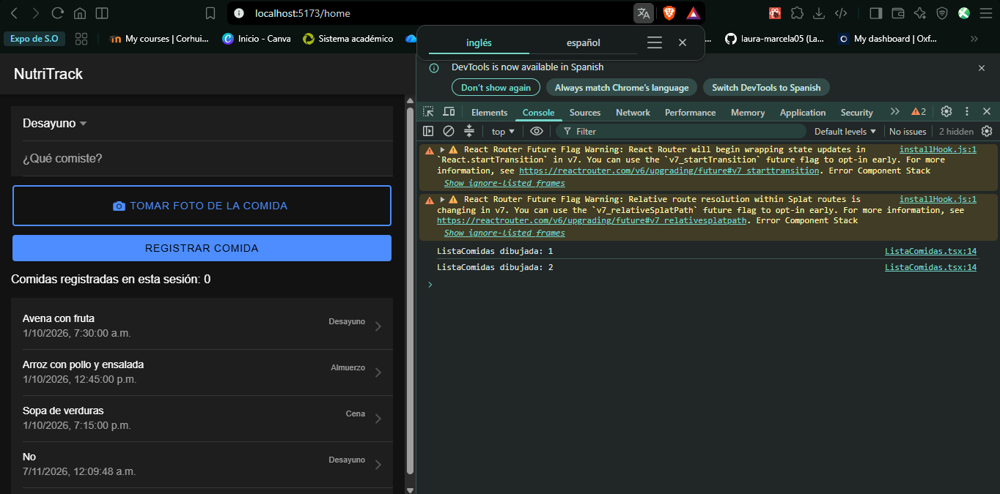
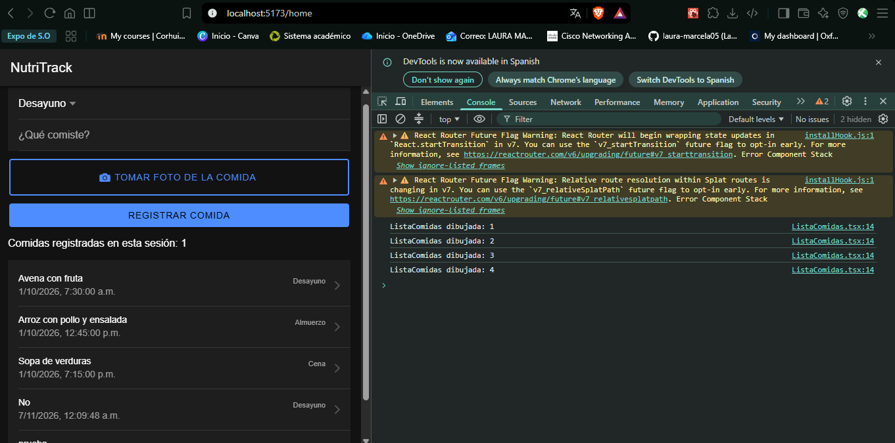
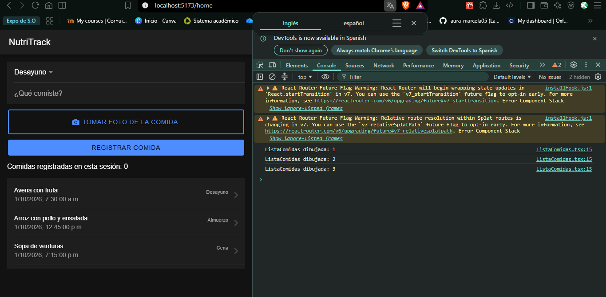
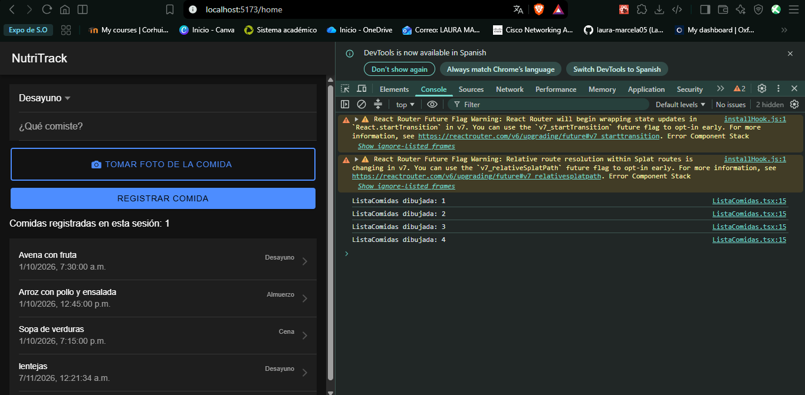
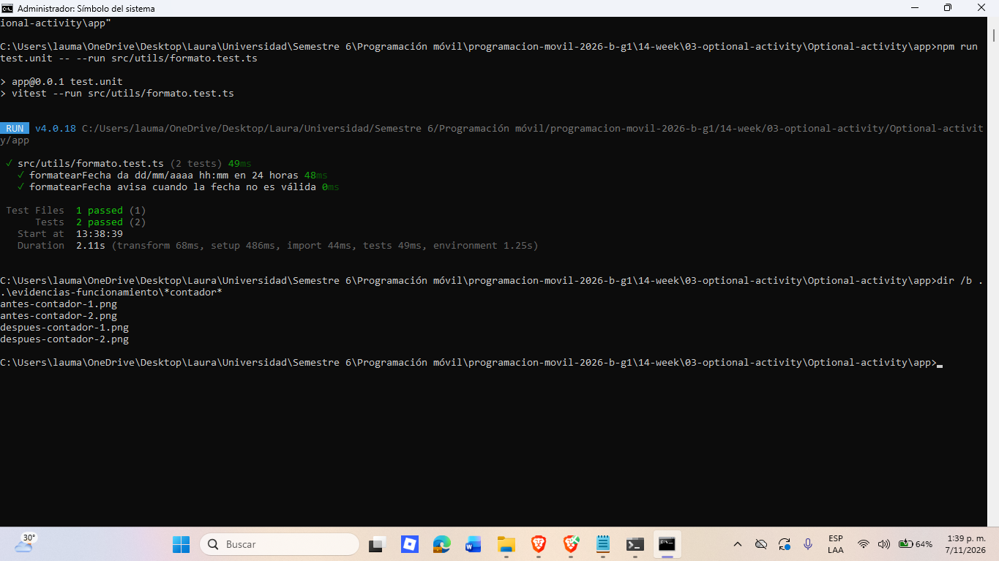

# NutriTrack · Semana 14: optimización y pruebas

Actividad formativa de Programación Móvil (Corte 3, 2026-B). Partí del proyecto de la semana 13 (Ionic React + TypeScript + Capacitor y API Node/Express) y trabajé sobre la lista de comidas de la pantalla principal.

## Cómo está dividida la app

El proyecto tiene dos partes independientes dentro de esta carpeta: `api/` (servidor) y `app/` (aplicación móvil). Cada una se instala y se levanta por separado.

```
Optional-activity/
├── api/                      API Node/Express (datos en memoria)
│   ├── server.js             arranca el servidor y exige JWT_SECRET
│   ├── routes/
│   │   ├── auth.js           POST /login (público): entrega el token
│   │   └── comidas.js        GET /, GET /:id y POST / (protegidas)
│   ├── middleware/
│   │   └── autenticacion.js  verificarToken: 401 si falta, venció o es inválido
│   ├── data/
│   │   ├── usuarios.js       usuario de prueba (clave guardada como hash)
│   │   └── comidas.js        comidas en memoria
│   └── .env.example          plantilla de variables (el .env no se sube)
├── app/                      Ionic React + TypeScript + Capacitor (Vite)
│   ├── src/
│   │   ├── main.tsx, App.tsx arranque y rutas (/login, /home, /detalle/:id)
│   │   ├── pages/            una pantalla por archivo
│   │   │   ├── Login.tsx     inicio de sesión
│   │   │   ├── Home.tsx      formulario + lista; pide las comidas a la API
│   │   │   └── Detalle.tsx   detalle de una comida
│   │   ├── components/       piezas reutilizables, sin llamar a la API
│   │   │   ├── FormularioComida.tsx  junta los campos y avisa a Home
│   │   │   ├── FotoComida.tsx        botón y vista de la foto
│   │   │   ├── ListaComidas.tsx      solo dibuja la lista (la optimizada)
│   │   │   └── MensajeError.tsx      muestra un error con reintento
│   │   ├── services/         comunicación con el exterior
│   │   │   ├── api.ts        único lugar con fetch: token, red y errores 401
│   │   │   ├── authApi.ts    login
│   │   │   ├── comidasApi.ts rutas de comidas (usa api.ts)
│   │   │   ├── tokenStorage.ts  token en almacenamiento seguro
│   │   │   └── fotoService.ts   acceso a la cámara
│   │   └── utils/
│   │       ├── formato.ts    formatearFecha (función pura)
│   │       └── formato.test.ts  las 2 pruebas unitarias
│   └── android/              proyecto Android generado por Capacitor
└── evidencias-funcionamiento/  capturas de las semanas 13 y 14
```

Cómo se reparten las responsabilidades: las **páginas** deciden qué pedir y qué hacer con la respuesta; los **componentes** solo reciben datos por props y los muestran; los **servicios** son los únicos que hablan con la API, la cámara o el almacenamiento; y **utils** guarda funciones puras que se pueden probar sin la app. Por eso `ListaComidas` solo dibuja y `Home` es quien llama a la API.

## 1. Optimización de la lista de comidas

### Qué sospechaba y cómo lo medí

Al registrar una comida, la pantalla `Home` cambia su estado dos veces: cuando se agrega la comida y cuando se cierra el aviso (toast). Mi sospecha era que `ListaComidas` se volvía a dibujar en las dos ocasiones aunque la lista no hubiera cambiado en la segunda.

Intenté medirlo con el Profiler de React DevTools, pero el panel se me quedaba cargando al detener la grabación. Por eso usé un contador temporal: un `console.count` dentro de un `useEffect` sin dependencias en `ListaComidas`, que se ejecuta una vez cada vez que el componente se dibuja. Lo quité al terminar. El procedimiento fue siempre el mismo:

1. Recargar la página (F5) y esperar a que aparezca la lista.
2. Anotar el último número del contador (N0).
3. Registrar una comida y esperar unos 3 segundos a que desaparezca el toast.
4. Anotar el último número (N1). Los dibujos causados por registrar la comida son N1 − N0.

En desarrollo React ejecuta los efectos dos veces al montar (modo estricto), así que comparo lo que sube al registrar y no el total.

### Resultados

| | Antes (sin `React.memo`) | Después (con `React.memo`) |
|---|---|---|
| Contador al cargar la lista (N0) | 2 | 3 |
| Contador tras registrar una comida (N1) | 4 | 4 |
| **Dibujos al registrar una comida (N1 − N0)** | **2** | **1** |

| Antes: N0 | Antes: N1 | Después: N0 | Después: N1 |
|---|---|---|---|
|  |  |  |  |

Registrar una comida pasó de dibujar la lista 2 veces a dibujarla 1 vez.

### Qué cambié

- `src/components/ListaComidas.tsx` se exporta con `React.memo`. React compara las props antes de dibujar: si el arreglo `comidas` es el mismo, se salta el dibujo. Cuando solo se cierra el toast, `comidas` no cambia, así que la lista no se redibuja.
- La fecha de cada fila ahora se arma con `formatearFecha` (ver sección 2) en lugar de `new Date(...).toLocaleString()`. Este cambio no influye en el conteo de dibujos. Visualmente, las fechas pasan de `1/10/2026, 7:30:00 a. m.` a `01/10/2026 07:30`.

No usé virtualización ni paginación porque la lista tiene pocas filas y lo que medí fue el desperdicio de dibujos repetidos, no el tamaño de la lista.

### Límites de la medición

- Medí en cada caso una sola vez, y solo conté dibujos; no medí tiempo en milisegundos.
-- Las condiciones no fueron idénticas: al cargar, el contador marcó 2 antes y 3 después, y la lista tenía más comidas en la medición de antes (venían de pruebas anteriores) que en la de después, donde solo estaban las 3 de ejemplo (reinicié la API entre ambas). No tengo una explicación comprobada de la diferencia al cargar; por eso comparo solo lo que sube al registrar.: al cargar, el contador marcó 2 antes y 3 después, y la lista tenía más comidas en la medición de antes (venían de pruebas anteriores) que en la de después, donde solo estaban las 3 de ejemplo (reinicié la API entre ambas). No tengo una explicación comprobada de la diferencia al cargar; por eso comparo solo lo que sube al registrar.
- No optimicé imágenes ni llamadas a la API en esta actividad.

## 2. Pruebas unitarias

Escribí la función `formatearFecha` en `app/src/utils/formato.ts`. Recibe una fecha ISO y devuelve `dd/mm/aaaa hh:mm` en 24 horas; si la fecha no es válida devuelve `Fecha inválida`. Tiene un parámetro opcional de zona horaria para que las pruebas den siempre el mismo resultado sin depender de la máquina.

Las 2 pruebas están en `app/src/utils/formato.test.ts` (Vitest):

1. Con una fecha conocida devuelve `01/10/2026 07:30` (en UTC) y `01/10/2026 07:45` (en `America/Bogota`).
2. Con un texto que no es fecha devuelve `Fecha inválida`.

Resultado de la ejecución: 1 archivo, 2 pruebas, las 2 pasaron.



No escribí pruebas de integración ni de interfaz; solo estas dos unitarias.

## 3. Cómo ejecutar

```
# API (Node 20.6+). Copia api/.env.example a api/.env y escribe una clave en JWT_SECRET
cd api
node --env-file=.env server.js

# App
cd app
npm install
npm run dev

# Pruebas
npm run test.unit -- --run src/utils/formato.test.ts
```

El usuario de prueba para iniciar sesión es el de la semana 13 (ver `api/data/usuarios.js`). La comprobación de tipos con `npx tsc --noEmit` pasa sin errores.