# NutriTrack · Semana 14 (calificable): app con hardware y conectividad

Entrega individual del Corte 3 de Programación Móvil (CORHUILA, 2026-B). Es mi proyecto NutriTrack, un diario de comidas hecho con Ionic React, TypeScript y Capacitor, con una API Node/Express. En esta entrega el foco está en la cámara con permisos, el login con token, el manejo de errores de red y los tres estados de la interfaz.

## Dónde está cada requisito

| Requisito | Dónde se ve |
|---|---|
| Plugin de Capacitor con permisos | `app/src/services/fotoService.ts`, `app/src/components/FotoComida.tsx`, sección 2 |
| Login por token, petición protegida, 401 y sin red | `app/src/services/api.ts`, `authApi.ts`, `tokenStorage.ts`, sección 3 |
| Navegación y tres estados | `app/src/pages/Home.tsx`, `Detalle.tsx`, sección 4 |
| Prueba unitaria | `app/src/utils/formato.test.ts`, sección 5 |
| Sección en inglés | "Quality & connectivity" |

## 1. Cómo está dividida la app

```
c3-activity/
├── api/                      API Node/Express (datos en memoria)
│   ├── server.js             arranca el servidor y exige JWT_SECRET
│   ├── routes/auth.js        POST /login (público): entrega el token
│   ├── routes/comidas.js     rutas de comidas (protegidas)
│   ├── middleware/autenticacion.js   verificarToken: 401 si falta, venció o es inválido
│   └── data/                 usuario de prueba y comidas en memoria
├── app/                      Ionic React + TypeScript + Capacitor (Vite)
│   └── src/
│       ├── pages/            Login, Home (formulario + lista) y Detalle
│       ├── components/       FormularioComida, FotoComida, ListaComidas, MensajeError
│       ├── services/         api.ts (único lugar con fetch), authApi, comidasApi,
│       │                     tokenStorage (almacenamiento seguro), fotoService (cámara)
│       └── utils/            formato.ts (formatearFecha) y formato.test.ts
└── evidencias-funcionamiento/   capturas
```

Las páginas deciden qué pedir; los componentes solo reciben datos y los muestran; los servicios son los únicos que hablan con la API, la cámara o el almacenamiento.

## 2. Plugin de cámara y permisos

Uso `@capacitor/camera`, y el permiso `CAMERA` está declarado en `AndroidManifest.xml`. `fotoService.ts` revisa el permiso, lo pide si hace falta y devuelve uno de cuatro resultados: ok, denegado, cancelado o error. `FotoComida.tsx` muestra la vista previa si hay foto y un mensaje si el permiso fue denegado; si el usuario cierra la cámara a propósito no muestra nada.

Lo probé en un celular Xiaomi real:

| Caso | Resultado que vi | Captura |
|---|---|---|
| Primera vez, permiso pedido por el sistema | Salió el diálogo y, al permitir, la foto se tomó bien | 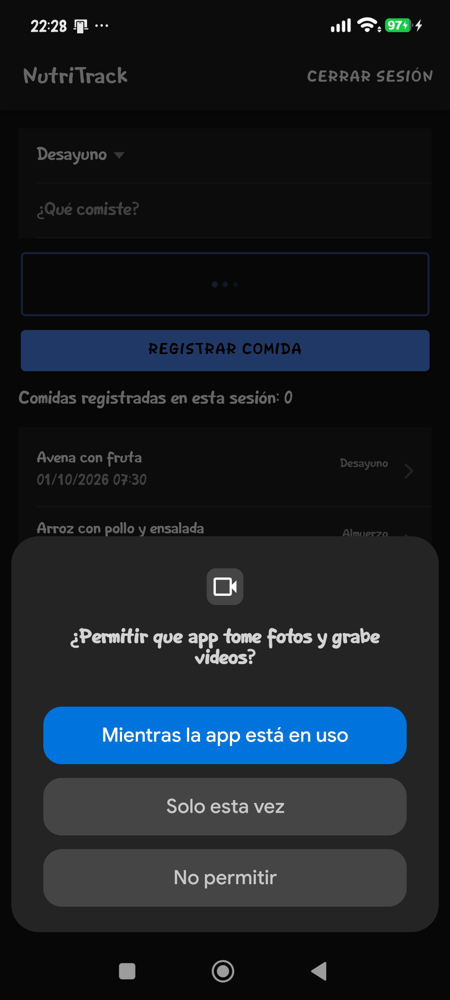 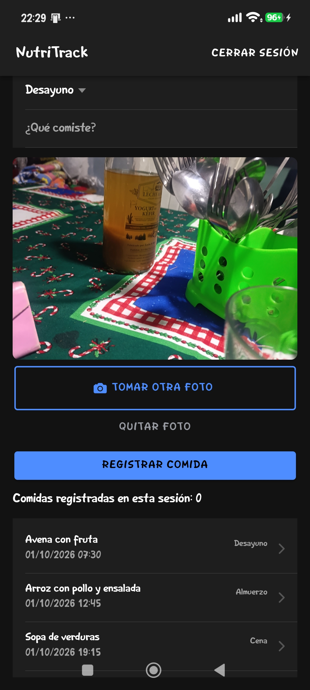 |
| Permiso denegado | La app explica cómo activarlo en Ajustes y recuerda que se puede registrar la comida sin foto | 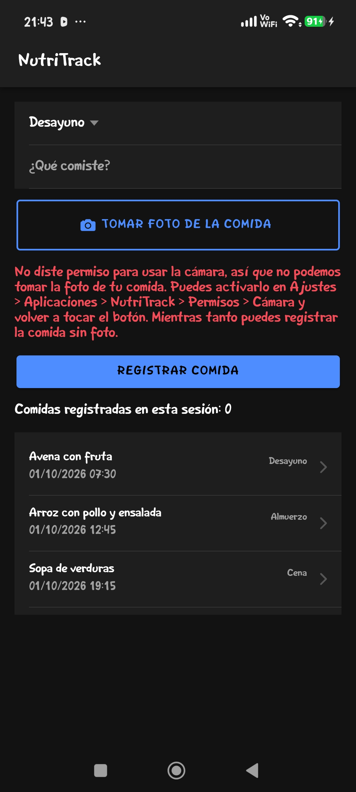 |
| Cerrar la cámara sin tomar foto | No aparece ningún mensaje | (sin captura) |
| Conceder el permiso desde Ajustes | Al volver a tocar el botón, la foto se tomó bien | (sin captura) |

Una observación: después de denegar, aunque pusiera el permiso en "Preguntar siempre", el sistema no volvió a mostrar el diálogo hasta que borré los datos de la app. Por eso el mensaje que lleva a Ajustes es el camino correcto en ese caso.

## 3. Token, petición protegida, 401 y sin red

- `POST /login` es público y devuelve un token JWT. La app lo guarda en almacenamiento seguro (`@aparajita/capacitor-secure-storage`).
- `GET /comidas` es la petición protegida: `api.ts` agrega `Authorization: Bearer <token>`.
- `api.ts` es el único lugar con `fetch`. Antes de enviar revisa la red con `@capacitor/network`, y distingue "sin internet" de "el servidor no responde".
- Si el servidor responde 401, borra el token y avisa para que la app vuelva al login.

| Caso | Captura |
|---|---|
| Login correcto, datos incorrectos y lista con token (semana 13) | 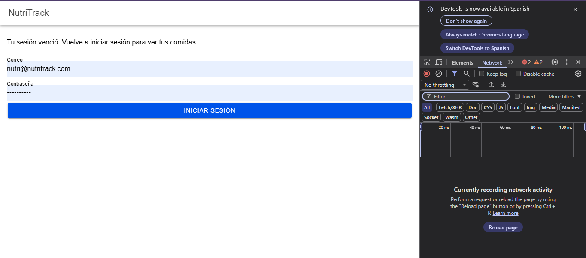 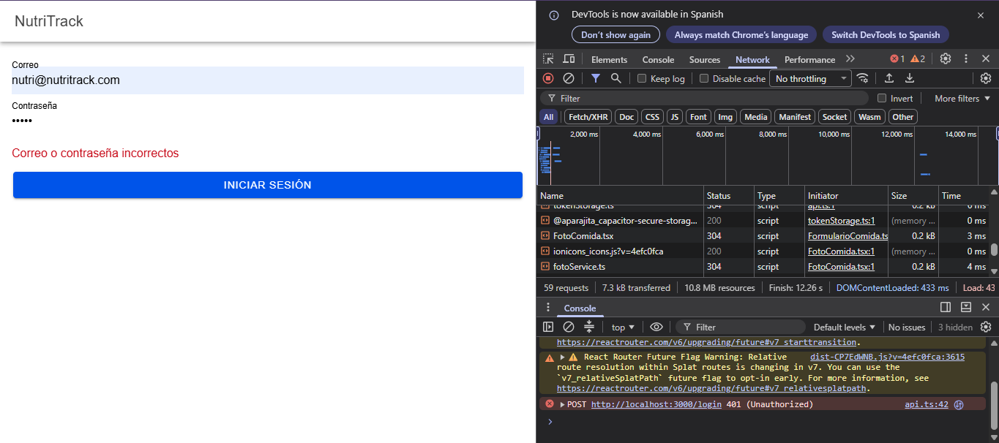 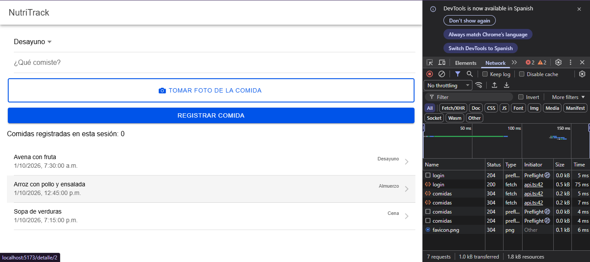 |
| Cabecera Authorization, `/comidas` sin token (401) y sesión vencida (semana 13) | 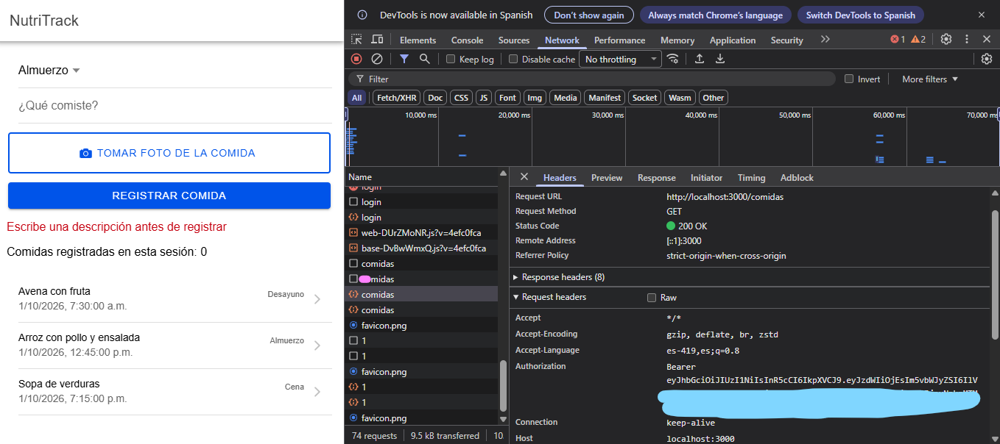 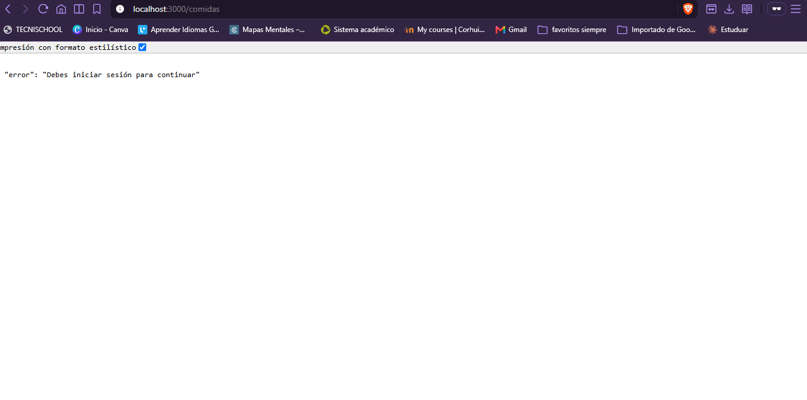 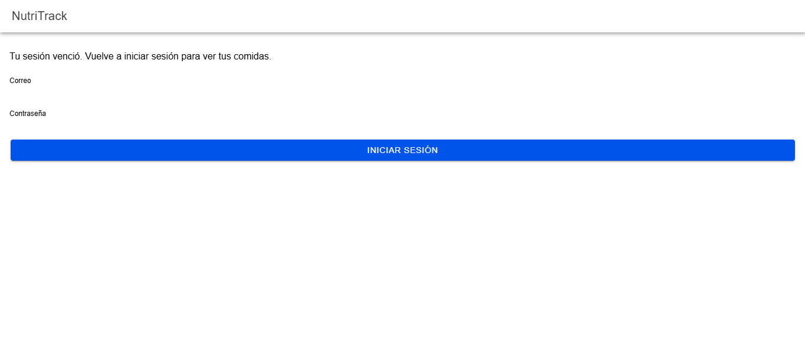 |
| Sesión guardada al cerrar y abrir la app, en el celular (semana 13) | 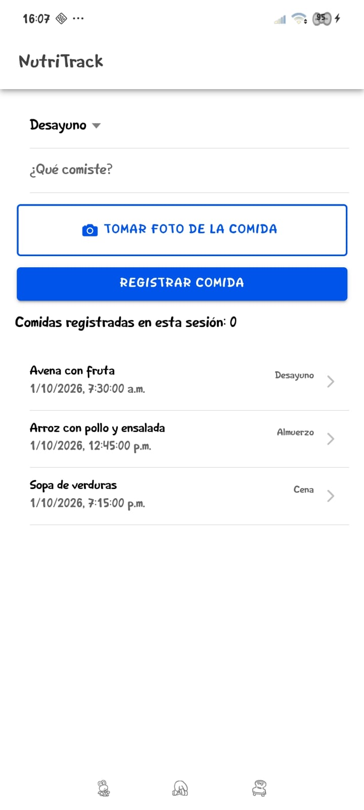 |
| Sin conexión (modo avión), en el celular | 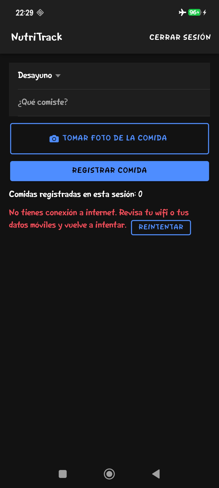 |
| Servidor apagado, en el celular | 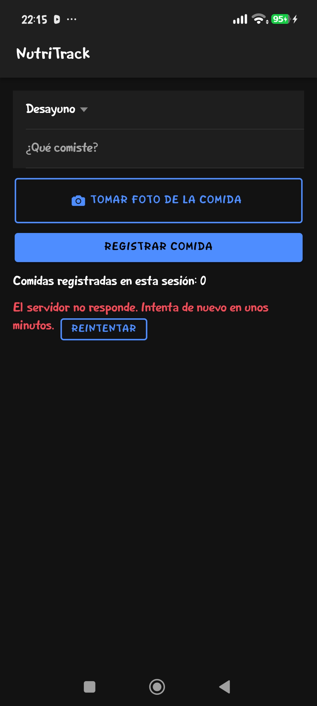 |

Las capturas `01` a `06` y `09` son de la semana 13: el código de `api.ts`, `authApi.ts` y `tokenStorage.ts` no cambió en esta entrega. Las pruebas de conectividad de `14` y `15`, y la recuperación con el botón Reintentar, las repetí ahora en el celular.

## 4. UX: navegación y los tres estados

- **Navegación:** Login → Home → Detalle. `Detalle` tiene botón de volver a Home. En Home agregué el botón **Cerrar sesión**, que borra el token y vuelve al login sin dejar la pantalla anterior en el historial.
- **Carga:** un indicador "Cargando…" mientras se piden las comidas.
- **Error:** el mensaje con un botón **Reintentar**; si hay error y no hay datos, solo se ve el error.
- **Datos:** la lista de comidas; si está vacía, muestra "Aún no hay comidas registradas".

Corregí un problema que encontré probando en el celular: con el servidor apagado se veía el error y, debajo, "Aún no hay comidas registradas", como si la lista estuviera vacía. Ahora cada estado se ve solo. También hice que `Detalle` muestre la fecha con el mismo formato que la lista.

| Pantalla | Captura |
|---|---|
| Botón Cerrar sesión en Home | 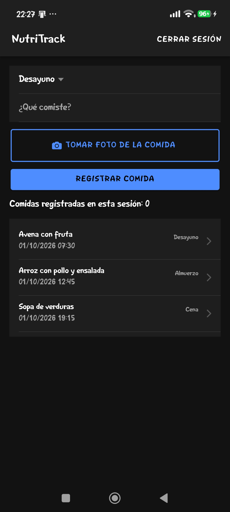 |
| Detalle de una comida | 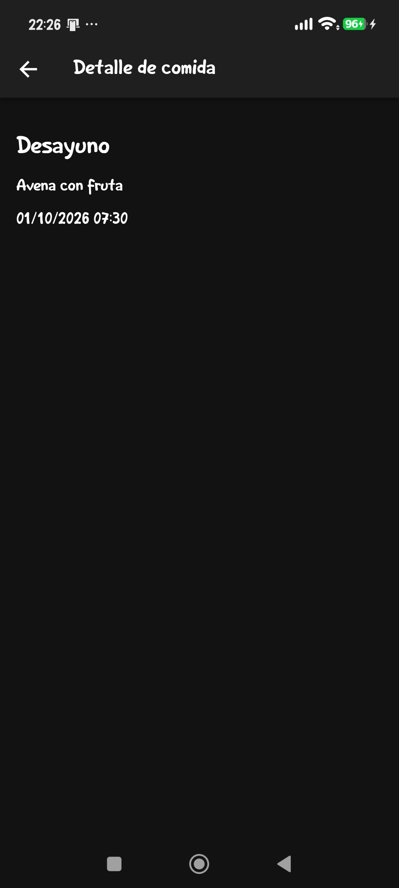 |

## 5. Prueba unitaria

`formatearFecha` (`app/src/utils/formato.ts`) convierte una fecha ISO en `dd/mm/aaaa hh:mm` y devuelve `Fecha inválida` si no es una fecha. En `app/src/utils/formato.test.ts` hay 2 pruebas (Vitest): una con una fecha conocida en dos zonas horarias y otra con un texto inválido. Ejecuté `npm run test.unit -- --run src/utils/formato.test.ts` en esta carpeta y pasaron las 2.

## Quality & connectivity

In this app I use the Capacitor Camera plugin, and I never assume that the camera is available. Before opening it, the code checks the current permission state and asks the user only when it is needed. If the user denies the permission, the app does not crash or keep insisting, and it shows a clear message that explains how to enable the camera in the phone settings. The same message says that the meal can still be saved without a photo. On my Xiaomi phone I noticed that after a denial Android did not show the prompt again, so that message is the only way forward for the user. For connectivity, every request goes through one service file, which is the only place that calls fetch. That service reads the JWT from secure storage, adds it to the Authorization header and checks the network status before sending the request. When the server answers with a 401, the service deletes the stored token and the app returns to the login screen, so an expired session never leaves the user on a broken page. When there is no internet or the server does not respond, the screen shows a specific error message with a Retry button, and I tested both cases on a real device. The HTTP traffic is limited to development, so this setup would need HTTPS before it is published.

## Límites

No implementé GPS (usé solo la cámara). La foto se ve en una vista previa, pero no se envía ni se guarda en la API. Los datos de la API están en memoria y hay un solo usuario de prueba. No hay HTTPS, caché sin conexión, refresh token ni pruebas de integración o de interfaz. El 401 y la sesión vencida los probé en la semana 13, no los repetí en esta entrega.

## Cómo ejecutar

```
# API (Node 20.6+). Copia api/.env.example a api/.env y escribe una clave en JWT_SECRET
cd api
npm install
node --env-file=.env server.js

# App en el navegador
cd app
npm install
npm run dev

# Prueba unitaria
npm run test.unit -- --run src/utils/formato.test.ts

# Celular Android (con la API encendida)
npm run build
npx cap sync android
adb reverse tcp:3000 tcp:3000
```

El usuario de prueba está en `api/data/usuarios.js`.