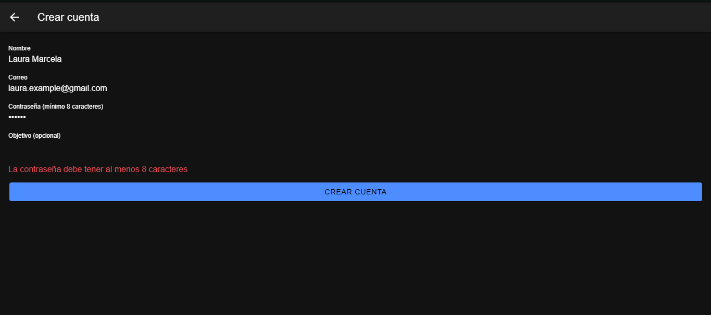
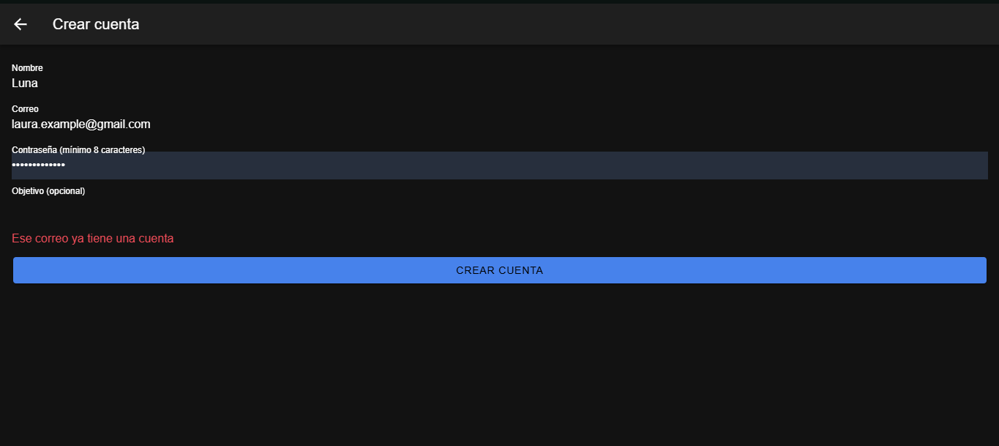
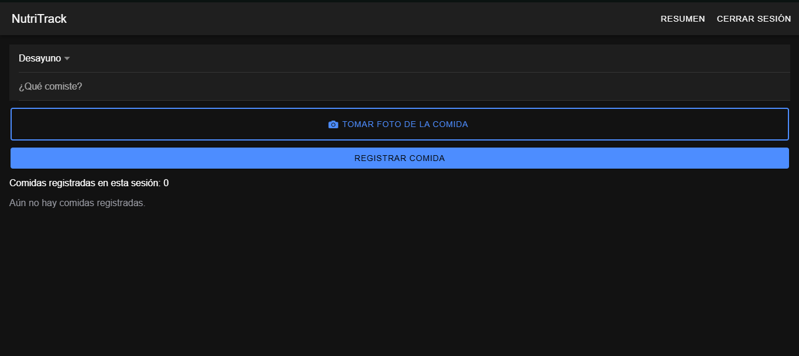
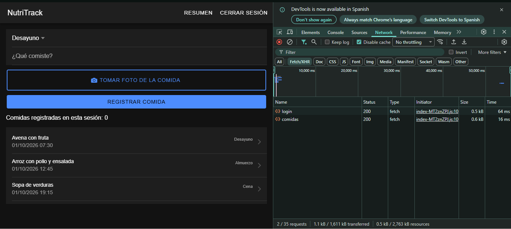
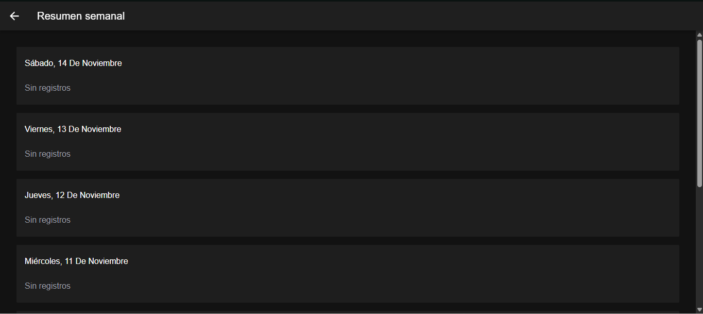
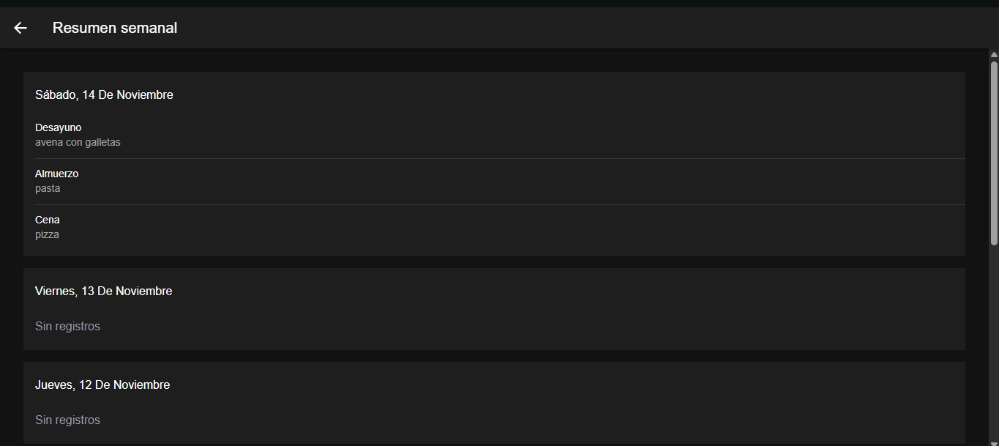
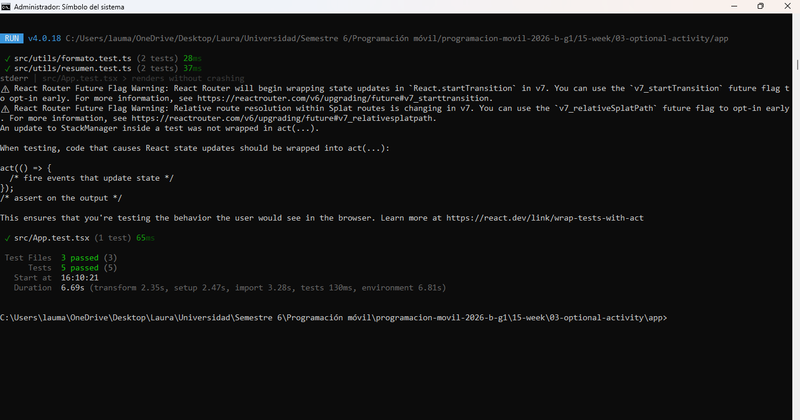

# NutriTrack · Semana 15 · Proyecto final (MVP)

Actividad formativa (opcional, sin nota) de Programación Móvil, Corte 3. Individual.

## 1. Problema

Mucha gente lleva el registro de lo que come en cuadernos, notas sueltas o de memoria, y así es difícil ver si de verdad está cambiando sus hábitos. NutriTrack es una app para llevar un control simple de la alimentación diaria: se registra lo que se come en cada franja (desayuno, almuerzo, cena) y se revisa la semana.

## 2. Por qué cambié de tecnología

En la semana 1 propuse una app web, porque no necesitaba funciones complejas. Al avanzar el proyecto necesité la cámara para fotografiar la comida y un almacenamiento seguro para el token de sesión, y esas dos cosas necesitan plugins nativos. Por eso la app es hoy **Ionic React + TypeScript con Capacitor**: Ionic me da las pantallas y la navegación, y Capacitor me da acceso a la cámara, al almacenamiento seguro y al estado de la red en el celular. Además es la tecnología en la que se trabajó en el curso.

## 3. Qué hace la app (MVP)

Flujo principal: **crear cuenta → iniciar sesión → registrar comida → ver el resumen semanal → cerrar sesión**.

- **Crear cuenta:** nombre, correo, contraseña (mínimo 8 caracteres) y objetivo opcional (bajar de peso, mantenerse en el peso o subir de peso).
- **Iniciar sesión:** la API devuelve un token que la app guarda en almacenamiento seguro.
- **Registrar comida:** franja, descripción y foto opcional con la cámara.
- **Resumen semanal:** las comidas de los últimos 7 días agrupadas por día; los días sin comidas dicen "Sin registros".
- **Estados de carga y error:** todas las pantallas que piden datos muestran "Cargando..." y, si falla, un mensaje con botón Reintentar.

## 4. Tecnologías

| Parte | Tecnología | Para qué |
|---|---|---|
| App | Ionic React, TypeScript, Vite | Pantallas, navegación y estado |
| Nativo | Capacitor 8, `@capacitor/network`, `@aparajita/capacitor-secure-storage`, cámara | Red, token seguro y foto |
| API | Node.js, Express, `jsonwebtoken`, `cors` | Login, registro y `/comidas` protegido |
| Claves | `crypto` de Node (scrypt con sal) | Guardar solo el hash de la contraseña |
| Pruebas | Vitest | Pruebas unitarias |

Decisiones que puedo defender:

- **Un solo servicio para la red (`api.ts`):** es el único lugar con `fetch`. Ahí se revisa la conexión, se agrega el token y se manejan el 401 y la falta de red; el resto de archivos solo dicen qué ruta llamar.
- **El token vence a los 15 minutos** y no se guarda en el almacenamiento común del navegador, sino en almacenamiento seguro.
- **El servidor valida todo** (campos, correo, contraseña y objetivo), aunque la app también lo haga, porque la app se puede saltar y el servidor no.
- **Si el correo ya existe, el registro lo dice** (409). En el login, en cambio, el mensaje de error es siempre el mismo, para no revelar qué correos están registrados.
- **El resumen semanal vive en una función aparte (`agruparPorDia`)** para poder probarla sin la pantalla.

## 5. Cómo ejecutarlo

Desde la carpeta de esta actividad, en cmd de Windows.

API:

```
cd api
npm install
copy .env.example .env
```

Abre `.env` y escribe una clave en `JWT_SECRET`. El archivo `.env` no se sube a git. Luego:

```
npm start
```

Debe decir `API en http://localhost:3000`. Usuario de prueba: `nutri@nutritrack.com`.

App (en otra ventana):

```
cd app
npm install
npm run dev
```

Se abre en `http://localhost:5173/`. Para el celular uso `adb reverse tcp:3000 tcp:3000` y Android Studio, igual que en la semana 13.

Pruebas:

```
cd app
npm run test.unit -- --run
```

## 6. Pruebas

Pasan **5 de 5**, en 3 archivos:

- `formato.test.ts`: 2 pruebas (de la semana 14).
- `resumen.test.ts`: 2 pruebas de `agruparPorDia` (nuevas en esta semana): reparte las comidas en su día dentro de los últimos 7 y deja vacíos los días sin registros ignorando fechas inválidas.
- `App.test.tsx`: 1 prueba de que la app se monta sin errores. Durante la ejecución sale un aviso de `act(...)` de React; la prueba pasa, y el aviso queda como límite conocido.

También probé a mano los casos de crear cuenta: contraseña corta, cuenta nueva, correo repetido y entrar con la cuenta nueva. Y comprobé en el build de producción que, tras iniciar sesión, `/comidas` se pide una sola vez; en el modo de desarrollo se pide dos veces porque React ejecuta los efectos dos veces (modo estricto).

## 7. Evidencias

Están en `evidencias-funcionamiento/`.

| Captura | Qué muestra |
|---|---|
|  | Crear cuenta con contraseña corta: avisa que debe tener al menos 8 caracteres |
|  | Crear cuenta con un correo ya registrado: "Ese correo ya tiene una cuenta" |
|  | Home después de crear la cuenta; la lista está vacía porque la cuenta es nueva |
|  | Build de producción: `login` y una sola llamada a `comidas`, ambas con 200 |
|  | Resumen semanal con días sin registros |
|  | Resumen semanal con una comida registrada hoy |
|  | Salida de las pruebas: 5 de 5 |

## 8. Diferencias con lo que planifiqué en el Corte 1

- **Tecnología:** de web a Ionic React con Capacitor (sección 2).
- **Usuario:** en el modelo de datos tenía peso, edad y estructura. La app pide solo nombre, correo, contraseña y objetivo.
- **Franja horaria:** en el modelo era una entidad aparte; en la app es un texto con las opciones desayuno, almuerzo y cena.
- **Resumen semanal:** en el Corte 1 indicaba qué comidas dejar o aumentar. Esta versión solo agrupa lo registrado por día y avisa los días sin registros; no da recomendaciones nutricionales.
- **Carpetas:** el material sugiere `frontend/` y `backend/`; mi proyecto usa `app/` y `api/`, con la misma función.

## 9. Estado

**Implementado y probado por mí:** crear cuenta (4 casos), iniciar sesión, resumen semanal, pruebas unitarias (5 de 5), `npm run build` sin errores de TypeScript y una sola llamada a `/comidas` en producción.

**Probado en el celular en la semana 14, no vuelto a probar en esta carpeta:** cámara con permisos, sesión guardada, errores de red con Reintentar y cerrar sesión. Los cambios de esta semana (crear cuenta y resumen) los probé solo en el navegador.

**No implementado (límites):**

- Editar o eliminar comidas (HU-04) e historial (HU-06).
- Caché local y uso sin conexión.
- Recomendaciones sobre qué comer o dejar de comer.
- Peso, edad y estructura del usuario.
- La foto no se envía ni se guarda en la API.
- Los usuarios y las comidas viven en memoria: al reiniciar la API se pierden las cuentas creadas y queda solo el usuario de prueba.
- Sin HTTPS real, sin refresh token y sin base de datos.
- Los ids de las comidas se calculan con `comidas.length + 1`.
- El build avisa de un archivo de más de 500 kB; no lo dividí.
- Aviso de `act(...)` en `App.test.tsx`.