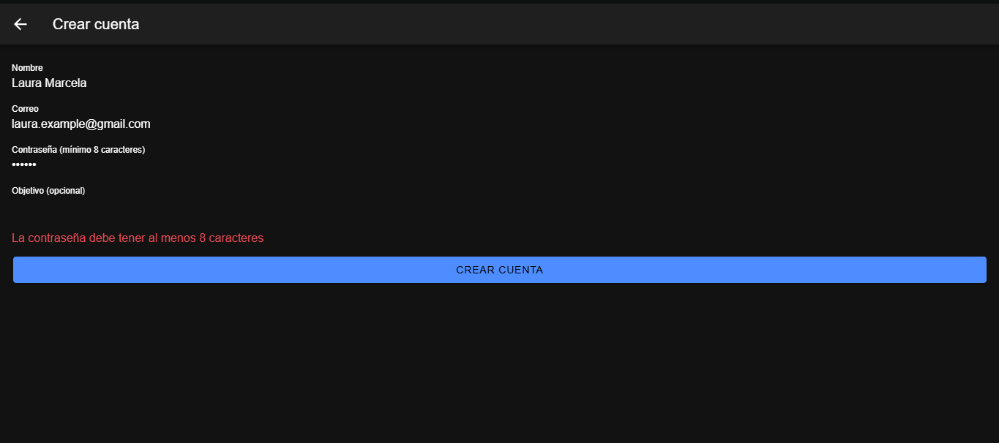
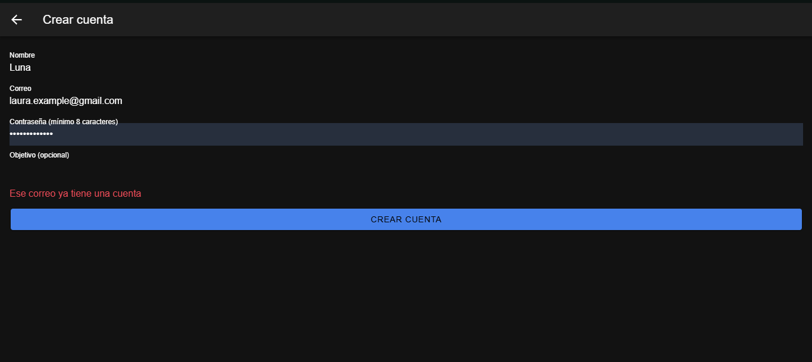
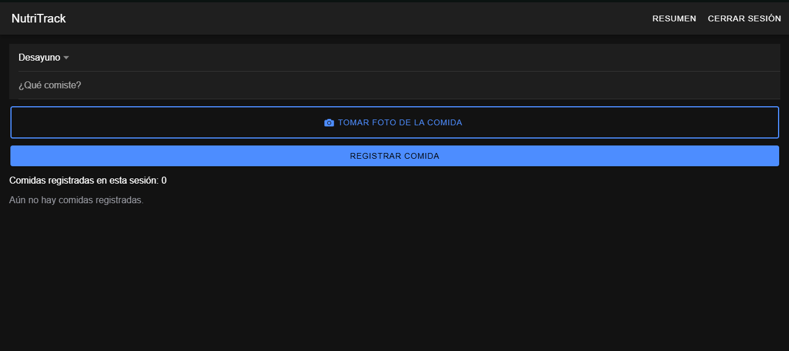
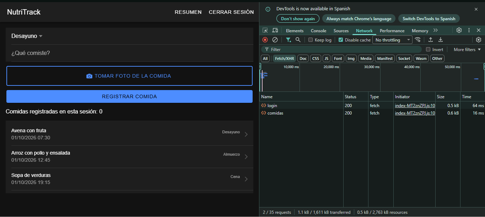
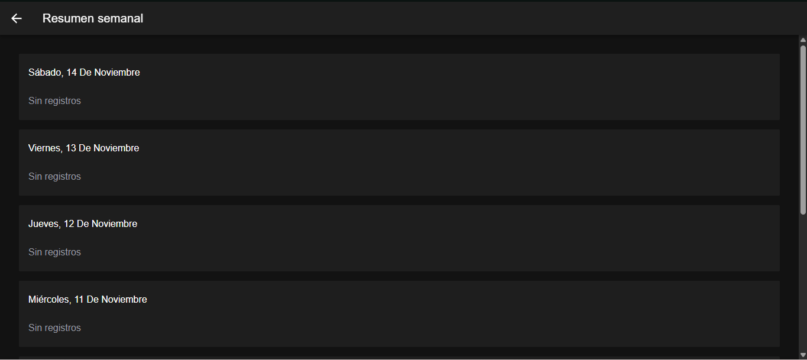
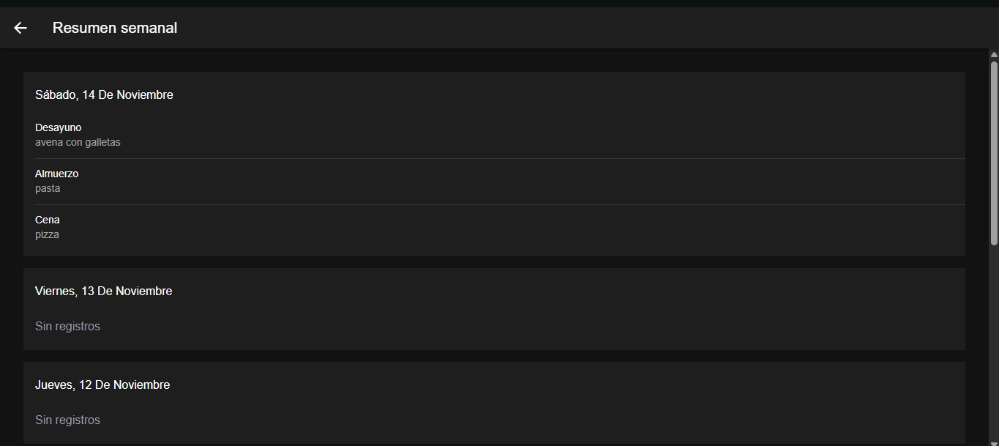
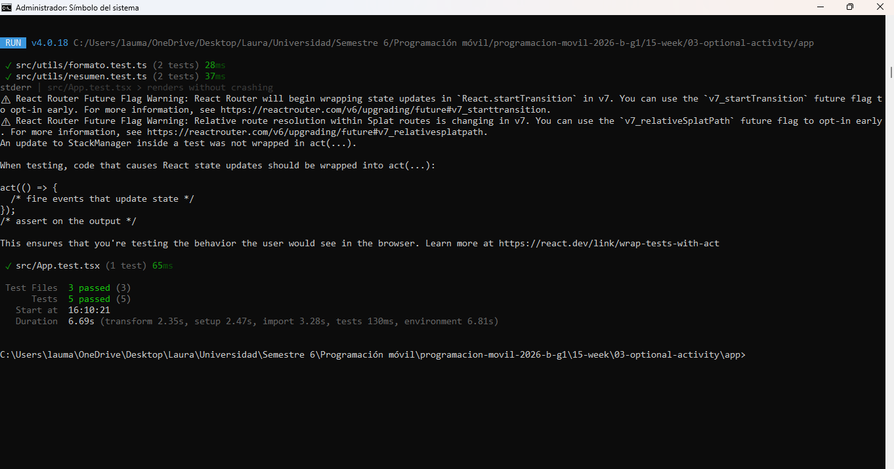
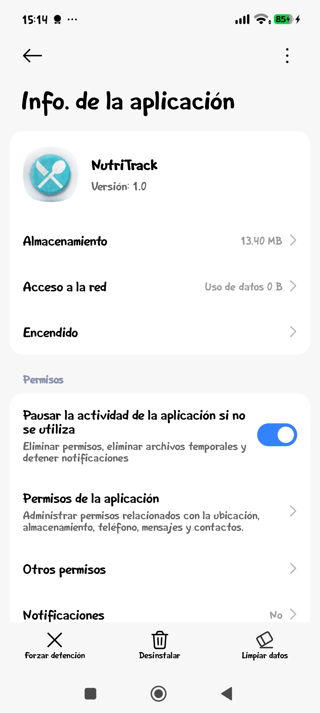
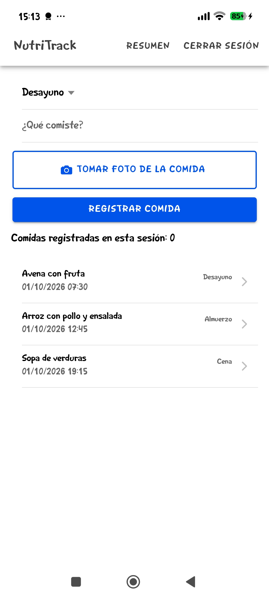

# NutriTrack · Entrada de portafolio

Asignatura: Programación Móvil (2026-B) · Semana 16 · Actividad formativa (opcional, sin nota), individual
Nombre: Laura Marcela Quintero · Usuario de GitHub: laura-marcela05

NutriTrack es una app para llevar un control simple de la alimentación diaria: se registra lo que se come en cada franja (desayuno, almuerzo, cena) y se revisa la semana. La hice con Ionic React, Capacitor y una API en Node.js.

Para esta última semana partí del código de la semana 15 y lo preparé para el despliegue. Todo está en este README:

| Parte | Dónde está |
|---|---|
| Cómo se prepara la app para una tienda | Sección "Despliegue" |
| Los ajustes de la revisión final | Sección "Revisión final" |
| La entrada de portafolio | Este README |

## Qué hace la app

Mucha gente lleva el registro de lo que come en cuadernos, notas sueltas o de memoria, y así es difícil ver si de verdad está cambiando sus hábitos. Flujo principal: **crear cuenta → iniciar sesión → registrar comida → ver el resumen semanal → cerrar sesión**.

- **Crear cuenta:** nombre, correo, contraseña (mínimo 8 caracteres) y objetivo opcional.
- **Iniciar sesión:** la API devuelve un token que la app guarda en almacenamiento seguro.
- **Registrar comida:** franja, descripción y foto opcional con la cámara.
- **Resumen semanal:** las comidas de los últimos 7 días agrupadas por día; los días vacíos dicen "Sin registros".
- **Estados de carga y error:** las pantallas que piden datos muestran "Cargando..." y, si falla, un mensaje con botón Reintentar.

## Capturas

Las pantallas no cambiaron esta semana (los ajustes fueron de despliegue y configuración), así que las capturas 01 a 07 son las de la semana 15. La 08 y la 09 son nuevas.

| Captura | Qué muestra |
|---|---|
|  | Crear cuenta con contraseña corta: avisa que debe tener al menos 8 caracteres |
|  | Crear cuenta con un correo ya registrado: "Ese correo ya tiene una cuenta" |
|  | Home después de crear la cuenta; la lista está vacía porque la cuenta es nueva |
|  | Build de producción: `login` y una sola llamada a `comidas`, ambas con 200 |
|  | Resumen semanal con días sin registros |
|  | Resumen semanal con una comida registrada hoy |
|  | Salida de las pruebas de la semana 15: 5 de 5 |
|  | El ícono nuevo de NutriTrack en el celular |
|  | La app instalada con el nombre NutriTrack |

## Tecnologías

| Parte | Tecnología | Para qué |
|---|---|---|
| App | Ionic React, TypeScript, Vite | Pantallas, navegación y estado |
| Nativo | Capacitor 8, `@capacitor/network`, `@aparajita/capacitor-secure-storage`, `@capacitor/camera` | Red, token seguro y foto |
| API | Node.js, Express, `jsonwebtoken`, `cors` | Login, registro y `/comidas` protegido |
| Claves | `crypto` de Node (scrypt con sal) | Guardar solo el hash de la contraseña |
| Pruebas | Vitest | Pruebas unitarias |

**Por qué cambié de tecnología.** En la semana 1 propuse una app web, porque no necesitaba funciones complejas. Al avanzar necesité la cámara para fotografiar la comida y un almacenamiento seguro para el token, y esas dos cosas necesitan plugins nativos. Por eso la app es hoy Ionic React con Capacitor: Ionic me da las pantallas y la navegación, y Capacitor me da acceso a la cámara, al almacenamiento seguro y al estado de la red.

## Arquitectura

```
  Pantallas      Login · Registro · Home · Resumen · Detalle
                              │
  Componentes    FormularioComida · ListaComidas · FotoComida · MensajeError
                              │
  Servicios      authApi · comidasApi · fotoService · tokenStorage
                              │
                 api.ts  (único lugar con fetch: red, token, 401, errores)
                              │
  Backend        API Express ──> verificarToken ──> /login · /registro · /comidas
```

Los servicios de la app usan plugins de Capacitor (cámara, almacenamiento seguro y red) para llegar al celular.

## Decisiones que tomé y por qué

- **Un solo servicio para la red (`api.ts`):** es el único lugar con `fetch`. Ahí se revisa la conexión, se agrega el token y se manejan el 401 y la falta de red; las pantallas solo muestran el mensaje.
- **El token vence a los 15 minutos** y se guarda en almacenamiento seguro, no en el del navegador.
- **El servidor valida todo** (campos, correo, contraseña y objetivo), aunque la app también lo haga, porque la app se puede saltar y el servidor no.
- **Si el correo ya existe, el registro lo dice** (409). En el login el mensaje de error es siempre el mismo, para no revelar qué correos están registrados.
- **El resumen semanal vive en una función aparte (`agruparPorDia`)** para poder probarla sin la pantalla.
- **Un estado a la vez en pantalla** (cargando, error con Reintentar, vacío o datos), para que nunca se mezclen.
- **Firmar el paquete fuera de `build.gradle`:** así la contraseña de la llave no queda en un archivo que se sube a GitHub.

## Cómo ejecutarlo

Desde la carpeta de esta actividad, en cmd de Windows.

API:

```
cd api
npm install
copy .env.example .env
```

Abre `.env` y escribe una clave en `JWT_SECRET`. El archivo `.env` no se sube a git. Luego:

```
npm start
```

Debe decir `API en http://localhost:3000`. Usuario de prueba: `nutri@nutritrack.com`.

App en el navegador (en otra ventana):

```
cd app
npm install
npm run dev
```

Se abre en `http://localhost:5173/`.

Pruebas:

```
cd app
npm run test.unit -- --run
```

En un celular Android, con depuración USB:

```
cd app
npm run build
npx cap sync android
adb reverse tcp:3000 tcp:3000
npx cap open android
```

En Android Studio se pulsa Run. Como cambié el identificador de la app, si el celular tiene una versión anterior sale como una app distinta y hay que iniciar sesión de nuevo.

## Despliegue: de la app a una tienda

Flujo que seguí: código → build web → proyecto nativo (Android) → paquete firmado → tienda. Hice los pasos hasta el paquete firmado; la subida a la tienda no.

| Paso | Qué hice | Por qué |
|---|---|---|
| 1. Build web | `npm run build` (compila TypeScript y genera `dist/`) | La tienda recibe la app compilada, no el código fuente |
| 2. Sincronizar | `npx cap sync android` (copia `dist/` al proyecto Android y actualiza los 7 plugins) | Sin esto el paquete llevaría la versión vieja de la web |
| 3. Identidad | Nombre `NutriTrack` y `applicationId` `com.lauramarcela05.nutritrack` (antes `app` e `io.ionic.starter`, los de la plantilla) | El nombre es lo que ve el usuario, y el ID identifica la app y no se puede cambiar después de publicarla |
| 4. Ícono | Android Studio → Image Asset (`ic_launcher`, adaptativo, con versión de 512 px para la ficha) | Genera todas las densidades de pantalla de una vez |
| 5. Permisos | Solo `CAMERA` (foto de la comida) e `INTERNET` (llamar a la API) | Cada permiso debe justificarse ante la tienda, así que pido solo los que uso |
| 6. Paquete firmado | `gradlew.bat bundleRelease` genera el AAB y `jarsigner` lo firma con mi keystore | Google Play pide AAB firmado; el APK sirve para probar en un celular |
| 7. Ficha de tienda | No la preparé (ver abajo) | |

Comandos del paso 6, en cmd, desde `app\android`:

```
set "JAVA_HOME=C:\Program Files\Android\Android Studio\jbr"
call gradlew.bat bundleRelease
"%JAVA_HOME%\bin\jarsigner.exe" -sigalg SHA256withRSA -digestalg SHA-256 -keystore C:\ruta\fuera\del\repo\nutritrack.jks app\build\outputs\bundle\release\app-release.aab nutritrack
"%JAVA_HOME%\bin\jarsigner.exe" -verify app\build\outputs\bundle\release\app-release.aab
```

`jarsigner` pide la contraseña del keystore en la consola. El keystore está fuera del repositorio y no se sube, igual que el `.env`.

**Ficha de tienda (lo que haría falta, no lo hice):** nombre, ícono, capturas, descripción, política de privacidad, justificación de los permisos y clasificación de edad. Las capturas ya las tengo en `evidencias-funcionamiento/` y el ícono de 512 px lo generó Image Asset.

**Estado del despliegue**

- **Hecho y probado por mí:** build web sin errores, sincronización con Android y la app instalada en mi celular Xiaomi: el nombre NutriTrack, el ícono nuevo, el inicio de sesión, la lista y el registro de una comida salieron bien.
- **Hecho y verificado, sin probar más allá:** el AAB firmado (`jarsigner -verify` dice `jar verified`). No lo subí a ninguna tienda ni lo instalé, porque un AAB no se instala directo en el celular.
- **No hecho:** publicar la app, la ficha y la política de privacidad, y la versión de iOS (el IPA necesita Xcode y yo trabajo en Windows).
- **Límites del paquete:** certificado autofirmado, código sin minificar (`minifyEnabled false`), versión `1.0` (`versionCode` 1) y JavaScript en un solo archivo de 1,4 MB.
- **Límite del backend:** la app llama a una API en `localhost` (HTTP, accesible por `adb reverse`). Una app instalada desde una tienda no tendría backend: haría falta alojar la API con HTTPS, y no lo hice.

## Revisión final

No recibí retroalimentación del docente en la demo, así que esta es una autorrevisión: ajustes que detecté yo misma.

| Hallazgo | Qué hice | Estado |
|---|---|---|
| La app tenía el nombre y el ID de la plantilla (`app`, `io.ionic.starter`) | Cambié el nombre y el `applicationId` (sección Despliegue, paso 3) | Probado en el celular |
| El ícono era el de Ionic | Ícono nuevo con Image Asset | Probado en el celular |
| En `Home`, si fallaba el registro de una comida y luego funcionaba, el mensaje de error se quedaba en pantalla junto al aviso de éxito | En `agregar` limpio el error antes de crear la comida (`setError('')`) | Probado: con la API apagada sale el error y al encenderla desaparece |
| Estados de carga, error y vacío | Revisé `Home` y `Resumen` leyendo el código: los tres estados están cubiertos | Revisado por lectura; las capturas 05 y 06 muestran el vacío y los datos |
| Ids de las comidas con `comidas.length + 1` | No lo cambié: la API no borra comidas, así que el id no se repite | Queda como límite si algún día se agrega el borrado |
| README | Lo reorganicé como entrada de portafolio y dejé explícitos los límites | Hecho |

## Qué aprendí

El curso recorre el camino completo de una app, y NutriTrack creció con cada tema:

| Unidad | Qué aprendí | Dónde se ve en NutriTrack |
|---|---|---|
| U1 · Planificación | A definir un MVP pequeño y priorizar historias de usuario antes de programar | La planificación del Corte 1: el problema, el MVP, el backlog y el modelo de datos |
| U2 · Tecnologías | Entorno, API REST con JSON y un framework híbrido | La API en Express y la app en Ionic React con componentes, estado y navegación |
| U3 · Experiencia | Estados de la interfaz, hardware con plugins, red y sesión, pruebas y despliegue | Cámara con permisos, login con token, manejo de 401 y falta de red, pruebas unitarias y el paquete firmado |

Lo que más me costó fue Android Studio. Era una herramienta nueva para mí: nunca la había usado ni ejecutado, y no sabía cómo manejarla. Con Capacitor la app se programa en React, pero para llevarla al celular hay que abrir el proyecto Android, y ahí tuve que aprender cosas que no conocía: sincronizar el proyecto, correr la app en mi celular, generar el ícono con Image Asset y firmar el paquete. Esta semana el keystore me falló al crearlo y después con la contraseña, y al final firmé el AAB por comandos.

Aprendí que publicar una app no es solo programarla: también hay que cambiar el nombre y el identificador de la plantilla, hacer el ícono y firmar el paquete.

## Estado

**Implementado y probado por mí:** crear cuenta (4 casos), iniciar sesión, resumen semanal, `npm run build` sin errores de TypeScript, una sola llamada a `/comidas` en producción y, en el Xiaomi, el nombre, el ícono, el login y el registro de comidas con el identificador nuevo.

**Probado en el celular en la semana 14, no vuelto a probar en esta carpeta:** permisos de la cámara, errores de red con Reintentar y cerrar sesión.

**Pruebas unitarias:** pasan 5 de 5 en esta carpeta (3 archivos). Durante la ejecución salen avisos de React Router y de `act(...)`; las pruebas pasan y dejo los avisos como límite conocido.

**No implementado (límites):**

- Editar o eliminar comidas e historial.
- Caché local y uso sin conexión.
- Recomendaciones sobre qué comer o dejar de comer.
- Peso, edad y estructura del usuario.
- La foto no se envía ni se guarda en la API.
- Los usuarios y las comidas viven en memoria: al reiniciar la API se pierden las cuentas creadas.
- Sin HTTPS real, sin refresh token y sin base de datos.
- Publicación en tienda, ficha y política de privacidad.
- El build avisa de un archivo de más de 500 kB; no lo dividí.
- Aviso de `act(...)` en `App.test.tsx`.

## Estructura

```
16-week/03-optional-activity/
├── README.md                    -> entrada de portafolio y despliegue
├── evidencias-funcionamiento/   -> capturas 01 a 09
├── api/                         -> API Node.js + Express
└── app/                         -> app Ionic React
    ├── capacitor.config.ts      -> appId com.lauramarcela05.nutritrack
    ├── android/                 -> proyecto Android con ícono e identificador nuevos
    └── src/                     -> pages, components, services y utils
```